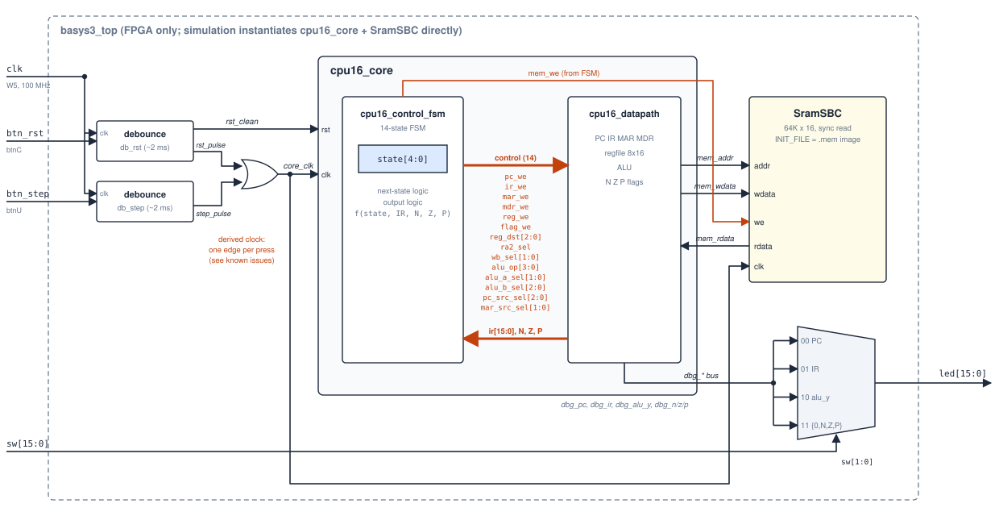

# 1. System overview and port interfaces

The core (`adam16_core`) is split the classic way:

- **`adam16_control_fsm`** holds the state register and is the only block that decodes the opcode. Each cycle it drives 14 control signals to the datapath, plus `mem_we` to memory.
- **`adam16_datapath`** holds PC, IR, MAR, MDR, the register file, the ALU and the N/Z/P flags. It reports `ir[15:0]` and `N, Z, P` back to the controller.

Memory sits outside the core on a simple synchronous single-port bus. In simulation the testbench wires `adam16_core` straight to `adam16_sram`. On the Basys3 board, `basys3_top` adds button debouncing, single-step clocking and an LED debug view.

## Clocking and reset

| | Simulation / ASIC flow | Basys3 (`basys3_top`) |
|---|---|---|
| Core and memory clock | `clk`, free-running | `core_clk = step_pulse \| rst_pulse`: exactly one rising edge per debounced button press |
| Reset | `rst`, held for ≥ 1 clock edge | `rst_clean` (debounced btnC level); the `rst_pulse` edge makes sure reset is sampled at least once |

The reset is synchronous and active high. One edge with `rst = 1` gives:

| State element | Reset value |
|---|---|
| FSM state | `S_IF0` |
| PC, IR, MAR, MDR | `0x0000` |
| R0–R7 | `0x0000` |
| N Z P | `0 1 0`. Exactly one flag is always set, so `BRnzp` is unconditional from the first instruction. |
| SRAM contents | Not reset. Loaded from `INIT_FILE` at simulation start / FPGA configuration. |

> The Basys3 clock is generated by logic rather than a clock buffer. It works for hand-stepping, but it is not a safe clocking scheme. See [known issues](06_known_issues.md#2-basys3_top-generates-a-clock-from-logic).

## Memory map

The address space is a single 64K-word space shared by instructions and data. There is no memory-mapped I/O.

| Address | Use |
|---|---|
| `0x0000` | Reset vector: the first instruction fetched |
| `0x0000–0x0FFF` | The only region `TRAP` can reach (`PC ← ZEXT(IR[11:0])`, a direct jump) |
| `0x0025` | `TRAP x025` is the HALT convention the testbench stops on |
| `0x0000–0xFFFF` | Unified instruction + data memory |

## Port interfaces

Every module has its own interface sheet in [`interfaces/`](interfaces/README.md), with a schematic symbol, port table, timing notes and instantiation template.

| Module | Role |
|---|---|
| [`adam16_core`](interfaces/adam16_core.md) | The processor: memory port + debug outputs |
| [`adam16_control_fsm`](interfaces/adam16_control_fsm.md) | Controller |
| [`adam16_datapath`](interfaces/adam16_datapath.md) | Registers, muxes, flags |
| [`adam16_regfile`](interfaces/adam16_regfile.md) | 8 × 16 register file |
| [`adam16_alu`](interfaces/adam16_alu.md) | 16-operation ALU |
| [`adam16_sram`](interfaces/adam16_sram.md) | 64K × 16 synchronous memory |
| [`basys3_top`](interfaces/basys3_top.md) | Basys3 wrapper |
| [`debounce`](interfaces/debounce.md) | Button synchronizer + debouncer |
| [`adam16_isa`](interfaces/adam16_isa.md) | Package: encodings and helpers |
