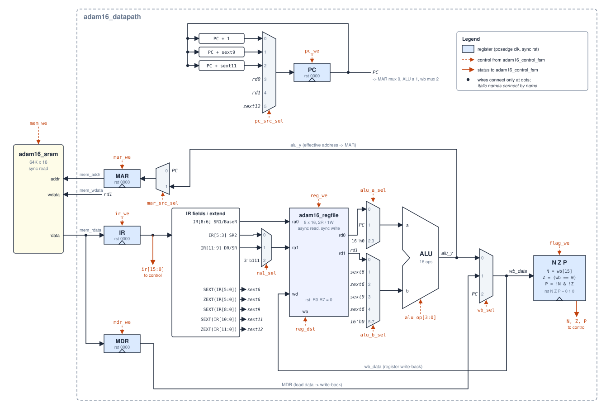

# 2. Datapath

This chapter, like chapters 3 to 5, describes the multicycle core, `adam16_core`. The pipelined core is in [chapter 7](07_pipeline.md).



How to read the diagram: wires connect only at dots. An *italic* name at a mux input connects to the net with the same name (`PC`, `rd0`, `rd1`, `sext9`, …). Dashed orange lines are control inputs from the FSM, and solid orange arrows are status outputs back to it.

## Storage elements

Every register below updates on the rising clock edge when its enable is high, and holds its value otherwise.

| Register | Width | Reset | Enable | Next value | Drives |
|---|---|---|---|---|---|
| PC | 16 | `0x0000` | `pc_we` | `pc_next` (PC mux) | PC adders, MAR mux 0, ALU a 1, write-back mux 2, `dbg_pc` |
| IR | 16 | `0x0000` | `ir_we` | `mem_rdata` | field slicing / extenders, controller (`ir`), `dbg_ir` |
| MAR | 16 | `0x0000` | `mar_we` | `mar_next` (MAR mux) | `mem_addr` |
| MDR | 16 | `0x0000` | `mdr_we` | `mem_rdata` | write-back mux 1 |
| N, Z, P | 1 each | `0, 1, 0` | `flag_we` | from `wb_data` (below) | controller, `dbg_n/z/p` |
| R0–R7 | 8 × 16 | `0x0000` | `reg_we` | `R[reg_dst] ← wb_data` | read ports `rd0`, `rd1` |

## Muxes and select codes

These tables are the encoding contract between `adam16_control_fsm` and `adam16_datapath`. The *Used in* column lists every state that selects that input. In any other state the select sits at its default of 0, and its value doesn't matter because the register it feeds isn't enabled.

### PC mux: `pc_src_sel[2:0]` → `pc_next`

When these are selected, PC already holds PC†, because PC was incremented in `S_IF2`.

| Code | `pc_next` | Used in |
|---|---|---|
| `000` | `PC + 1` | `S_IF2` (fetch increment) |
| `001` | `PC + SEXT(IR[8:0])` | `S_EX_BR` when the branch is taken |
| `010` | `PC + SEXT(IR[10:0])` | `S_EX_JSR`, JSR form (`IR[11] = 0`) |
| `011` | `rd0` = `R[IR[8:6]]` | `S_EX_JMP` (JMP), `S_EX_JSR` JSRR form (`IR[11] = 1`) |
| `100` | `rd1` = R7 (with `ra1_sel = 10`) | `S_EX_JMP` (RET) |
| `101` | `ZEXT(IR[11:0])` | `S_EX_TRAP` |
| `110`, `111` | `PC` (hold) | unused |

### MAR mux: `mar_src_sel[1:0]` → `mar_next`

| Code | `mar_next` | Used in |
|---|---|---|
| `00` | `PC` | `S_IF0` (instruction address) |
| `01` | `alu_y` | `S_EX_EA` (load/store effective address) |
| `10`, `11` | `MAR` (hold) | unused |

### ALU operand A: `alu_a_sel[1:0]`

| Code | `alu_a` | Used for |
|---|---|---|
| `00` | `rd0` = `R[IR[8:6]]` (SR1 / BaseR) | ALU0, ALU1, ADDI, ANDI, LDR/STR address |
| `01` | `PC` (= PC†) | LEA, LD/ST address |
| `10`, `11` | `16'h0000` | unused |

### ALU operand B: `alu_b_sel[2:0]`

| Code | `alu_b` | Used for |
|---|---|---|
| `000` | `rd1` = `R[IR[5:3]]` (SR2) | two-operand ALU0 / ALU1 ops, CMP |
| `001` | `SEXT(IR[5:0])` | ADDI (imm6, −32…31) |
| `010` | `ZEXT(IR[5:0])` | ANDI (imm6, 0…63) |
| `011` | `SEXT(IR[8:0])` | LEA, LD/ST address (off9) |
| `100` | `SEXT(IR[5:0])` | LDR/STR address (off6). Same value as `001`; a separate code for the offset role |
| `111` | `16'h0000` | one-operand ops (NOT, NEG, INC, DEC, LSL1, LSR1, ASR1): `b` is ignored, so it is driven to 0 |
| `101`, `110` | `16'h0000` | unused |

### Write-back mux: `wb_sel[1:0]` → `wb_data`

`wb_data` is both the register-file write data and the input to the flag logic.

| Code | `wb_data` | Used in |
|---|---|---|
| `00` | `alu_y` | `S_EX_ALU` |
| `01` | `MDR` | `S_WB_LD` |
| `10` | `PC` (= PC†, the return address) | `S_EX_JSR`, `S_EX_TRAP` (written to R7) |
| `11` | `16'h0000` | unused |

### Register-file read port 1: `ra1_sel`

| Code | `ra1` | Used for |
|---|---|---|
| `00` | `IR[5:3]` | default. SR2 for two-operand ALU ops and CMP |
| `01` | `IR[11:9]` | `S_MEM_WR0`: the ST/STR source register, which drives `mem_wdata` |
| `10` | `3'b111` (R7) | `S_EX_JMP` when the opcode is RET |
| `11` | `IR[5:3]` | unused |

Port 0's address is always `ra0 = IR[8:6]` (SR1 / BaseR). The write address `wa = reg_dst` comes from the controller (`IR[11:9]` or `3'b111`).

## ALU: `alu_op[3:0]`

The ALU is pure combinational logic with 16 operations. `alu_op = {group, funct}`, which for ALU0/ALU1 instructions is exactly `{IR[12], IR[2:0]}`, because the two opcodes differ only in bit 12. Everything else uses ADD (`0000`), except ANDI, which uses AND (`0011`). The full operation table is on the [`adam16_alu` interface page](interfaces/adam16_alu.md#operations).

**CMP** (`1111`) is a signed three-way compare: the ALU returns `−1`, `0` or `+1`, so the ordinary flag logic below sets exactly N, Z or P for SR1 < SR2, SR1 = SR2 or SR1 > SR2. Because it compares instead of subtracting, it is right even where `SR1 − SR2` would overflow (for example `0x7FFF` vs `0x8000`). There is no carry or overflow output.

## Condition flags

```
N ← wb_data[15]
Z ← (wb_data == 16'h0000)
P ← ~wb_data[15] & (wb_data != 16'h0000)        // written only when flag_we = 1
```

The flags are computed from `wb_data`, after the write-back mux, so they always describe the value written to DR (or, for CMP, the value that would have been written). `flag_we` is raised only in `S_EX_ALU`, and not for LEA. Loads, LEA, JSR/JSRR and TRAP leave the flags alone. Exactly one flag is set at any time: an ALU result sets exactly one of them, and reset loads `Z = 1`.

## Register file

`adam16_regfile` is 8 × 16 bits, with two asynchronous (combinational) read ports and one synchronous write port. No state ever needs more than two reads at once.

- **No write-to-read bypass here (`BYPASS = 0`).** A read of the register being written in the same cycle returns the *old* value. In this multicycle design that never matters, because the next instruction's first read is at least four cycles after the write. The pipelined core instantiates the same register file with `BYPASS = 1`.
- **JSRR R7 works.** `S_EX_JSR` reads R7 through `rd0` for the new PC while writing the return address into R7. Both happen on the same clock edge, so PC gets the *old* R7, which is correct.
- **R0 is an ordinary register.** It is cleared by reset but not hard-wired to zero. Programs that use it as a zero source (the `sum_array` example does) depend on nobody writing it.

## Design notes

- **Three PC adders.** `PC + 1`, `PC + SEXT(off9)` and `PC + SEXT(off11)` each have their own adder in front of the PC mux, while LEA and LD/ST compute `PC + SEXT(off9)` again in the ALU. That costs area but keeps the PC path independent of the ALU, so a branch only needs one state.
- **MAR in front of memory.** Registering the address gives memory a clean, glitch-free address straight from a flop. The price is one extra cycle on every memory access ([memory interface](04_memory.md)).

## Port interfaces

See the interface sheets: [`adam16_datapath`](interfaces/adam16_datapath.md), [`adam16_regfile`](interfaces/adam16_regfile.md), [`adam16_alu`](interfaces/adam16_alu.md).
