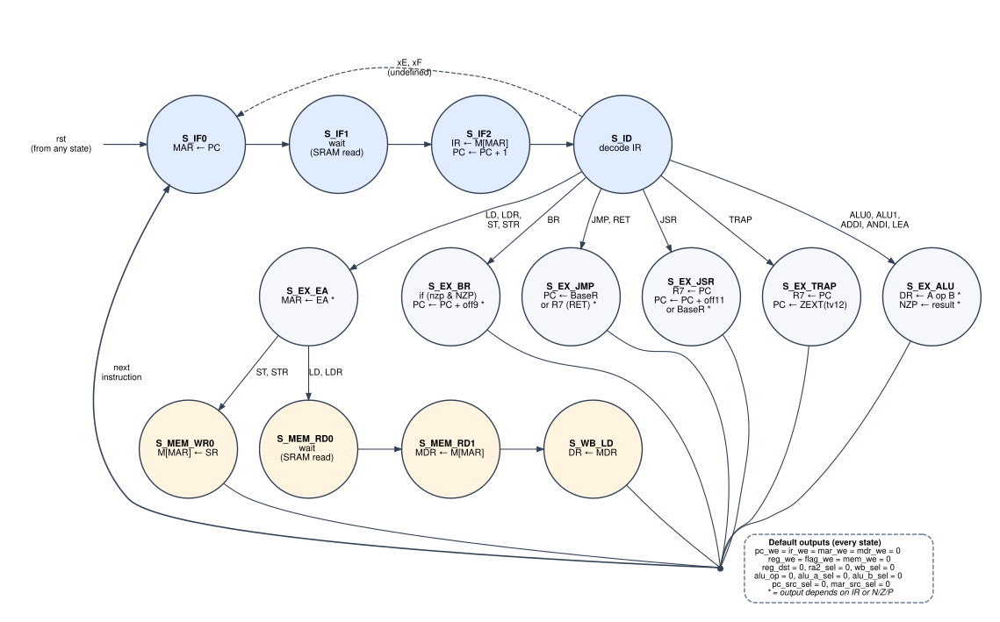

# 3. Control

`cpu16_control_fsm` is a 14-state finite state machine. Every instruction starts at `S_IF0`, spends three cycles in fetch, one in decode, and then one to four cycles in an execute path before returning to `S_IF0`.



How to read the diagram:
- Each bubble shows the state name and the register transfer that happens on the clock edge that *ends* that state.
- Arc labels are next-state conditions on the opcode; an unlabelled arc is taken unconditionally.
- All the return-to-fetch arcs meet at one point to keep the drawing readable.
- `rst` forces `S_IF0` from any state on the next clock edge.
- Outputs that aren't listed are 0 (the defaults box).
- A `*` marks a state whose outputs also depend on IR or the flags. See [Moore or Mealy?](#moore-or-mealy).

## States

The state register is 5 bits, binary encoded in the order below. Synthesis tools may re-encode it (Vivado's FSM extraction often picks one-hot). Codes 14–31 are unreachable, and the `default` branch sends them back to `S_IF0`.

| State | Code | Phase | Register transfer (on the closing edge) | Next state |
|---|---|---|---|---|
| `S_IF0` | 0 | fetch | MAR ← PC | `S_IF1` |
| `S_IF1` | 1 | fetch | — (memory reads `M[MAR]`) | `S_IF2` |
| `S_IF2` | 2 | fetch | IR ← `M[MAR]`, PC ← PC + 1 | `S_ID` |
| `S_ID` | 3 | decode | — | by opcode (below) |
| `S_EX_ALU` | 4 | execute | DR ← A op B; N Z P ← f(result). CMP writes flags only; LEA writes DR only | `S_IF0` |
| `S_EX_EA` | 5 | execute | MAR ← EA: PC† + SEXT(off9) for LD/ST, BaseR + SEXT(off6) for LDR/STR | `S_MEM_RD0` if LD/LDR, else `S_MEM_WR0` |
| `S_MEM_RD0` | 6 | memory | — (memory reads `M[MAR]`) | `S_MEM_RD1` |
| `S_MEM_RD1` | 7 | memory | MDR ← `M[MAR]` | `S_WB_LD` |
| `S_WB_LD` | 8 | write-back | DR ← MDR | `S_IF0` |
| `S_MEM_WR0` | 9 | memory | `M[MAR]` ← SR | `S_IF0` |
| `S_EX_BR` | 10 | execute | if `take_br`: PC ← PC† + SEXT(off9) | `S_IF0` |
| `S_EX_JMP` | 11 | execute | PC ← BaseR (JMP) or R7 (RET) | `S_IF0` |
| `S_EX_JSR` | 12 | execute | R7 ← PC†; PC ← PC† + SEXT(off11) (JSR) or BaseR (JSRR) | `S_IF0` |
| `S_EX_TRAP` | 13 | execute | R7 ← PC†; PC ← ZEXT(IR[11:0]) | `S_IF0` |

### Decode: next state from `S_ID`

| Opcode `IR[15:12]` | Instructions | Next state |
|---|---|---|
| `0000`, `0001`, `0010`, `0011`, `1100` | ALU0, ALU1, ADDI, ANDI, LEA | `S_EX_ALU` |
| `0100`, `0101`, `1010`, `1011` | LD, ST, LDR, STR | `S_EX_EA` |
| `1101` | BR | `S_EX_BR` |
| `0110`, `1000` | JMP, RET | `S_EX_JMP` |
| `0111` | JSR, JSRR | `S_EX_JSR` |
| `1001` | TRAP | `S_EX_TRAP` |
| `1110`, `1111` | undefined | `S_IF0`: the instruction is a 4-cycle no-op |

### Branch condition

```
take_br = (IR[11] & N) | (IR[10] & Z) | (IR[9] & P)
```

`IR[11:9]` is the instruction's `nzp` mask. With mask `111` the branch is always taken, because exactly one flag is always set (see [flags](02_datapath.md#condition-flags)). With mask `000` it is never taken, so `BR` with an empty mask is a 5-cycle no-op.

## Control-signal table

This table is the complete behaviour of the controller. Rows that differ by opcode within one state are separate sub-rows. Codes match the [datapath select tables](02_datapath.md#muxes-and-select-codes).

- `1` = raised.
- A code (e.g. `011`) = that select value, and the value matters in this state.
- `·` = left at the default 0, and it either matters as 0 (enables) or doesn't matter in this state (selects).
- `DR` means `IR[11:9]`.

| State | Case | `pc_we` | `ir_we` | `mar_we` | `mdr_we` | `reg_we` | `flag_we` | `mem_we` | `reg_dst` | `ra2_sel` | `wb_sel` | `alu_op` | `alu_a_sel` | `alu_b_sel` | `pc_src_sel` | `mar_src_sel` |
|---|---|---|---|---|---|---|---|---|---|---|---|---|---|---|---|---|
| `S_IF0` | | · | · | 1 | · | · | · | · | · | · | · | · | · | · | · | `00` PC |
| `S_IF1` | | · | · | · | · | · | · | · | · | · | · | · | · | · | · | · |
| `S_IF2` | | 1 | 1 | · | · | · | · | · | · | · | · | · | · | · | `000` +1 | · |
| `S_ID` | | · | · | · | · | · | · | · | · | · | · | · | · | · | · | · |
| `S_EX_ALU` | ADD SUB AND OR XOR MOV | · | · | · | · | 1 | 1 | · | DR | · | `00` | `{0,funct}` | `00` | `000` | · | · |
| | NOT NEG | · | · | · | · | 1 | 1 | · | DR | · | `00` | `{0,funct}` | `00` | `111` | · | · |
| | NAND NOR | · | · | · | · | 1 | 1 | · | DR | · | `00` | `{1,funct}` | `00` | `000` | · | · |
| | INC DEC LSL1 LSR1 ASR1 | · | · | · | · | 1 | 1 | · | DR | · | `00` | `{1,funct}` | `00` | `111` | · | · |
| | CMP | · | · | · | · | · | 1 | · | · | · | `00` | `1111` | `00` | `000` | · | · |
| | ADDI | · | · | · | · | 1 | 1 | · | DR | · | `00` | `0000` | `00` | `001` | · | · |
| | ANDI | · | · | · | · | 1 | 1 | · | DR | · | `00` | `0011` | `00` | `010` | · | · |
| | LEA | · | · | · | · | 1 | · | · | DR | · | `00` | `0000` | `01` | `011` | · | · |
| `S_EX_EA` | LD, ST | · | · | 1 | · | · | · | · | · | · | · | `0000` | `01` | `011` | · | `01` alu_y |
| | LDR, STR | · | · | 1 | · | · | · | · | · | · | · | `0000` | `00` | `100` | · | `01` alu_y |
| `S_MEM_RD0` | | · | · | · | · | · | · | · | · | · | · | · | · | · | · | · |
| `S_MEM_RD1` | | · | · | · | 1 | · | · | · | · | · | · | · | · | · | · | · |
| `S_WB_LD` | | · | · | · | · | 1 | · | · | DR | · | `01` MDR | · | · | · | · | · |
| `S_MEM_WR0` | | · | · | · | · | · | · | 1 | · | `0` SR | · | · | · | · | · | · |
| `S_EX_BR` | | `take_br` | · | · | · | · | · | · | · | · | · | · | · | · | `001` +off9 (if taken) | · |
| `S_EX_JMP` | JMP | 1 | · | · | · | · | · | · | · | · | · | · | · | · | `011` rd0 | · |
| | RET | 1 | · | · | · | · | · | · | · | `1` R7 | · | · | · | · | `100` rd2 | · |
| `S_EX_JSR` | JSR (`IR[11]=0`) | 1 | · | · | · | 1 | · | · | `111` | · | `10` PC | · | · | · | `010` +off11 | · |
| | JSRR (`IR[11]=1`) | 1 | · | · | · | 1 | · | · | `111` | · | `10` PC | · | · | · | `011` rd0 | · |
| `S_EX_TRAP` | | 1 | · | · | · | 1 | · | · | `111` | · | `10` PC | · | · | · | `101` tv12 | · |

Notes on the table:
- **MOV** keeps `alu_b_sel = 000`. PASS ignores `b`, so whatever `R[IR[5:3]]` holds doesn't matter. Only NOT and NEG explicitly zero `b`.
- **CMP** still drives `reg_dst = DR` in the RTL. It's left out of the table because `reg_we = 0` makes it irrelevant.
- **Stores** use the default `ra2_sel = 0`, so `mem_wdata = R[IR[11:9]]`. That's the SR field of ST/STR.

## Moore or Mealy?

Every control output is a function of `(state, IR, N, Z, P)`. Two consequences:

1. **The timing behaves like a Moore machine.** IR and N/Z/P are registers inside the datapath, so no control output has a combinational path from any input of `cpu16_core`, and in particular none from `mem_rdata`. Outputs settle shortly after each clock edge and stay stable for the rest of the cycle. `mem_we` depends on the state register alone.
2. **The notation is not strictly Moore.** A strict Moore bubble lists fixed outputs, but `S_EX_ALU`, `S_EX_EA`, `S_EX_BR`, `S_EX_JMP` and `S_EX_JSR` drive different values depending on IR or the flags. That is what the `*` in the diagram and the sub-rows in the table capture. A strictly Moore version would split those states up: `S_EX_ALU` into one state per operation group, `S_EX_BR` into taken / not-taken, and so on, with `S_ID` choosing among them. The behaviour would be identical, with more states.

## Port interface: `cpu16_control_fsm`

All outputs are combinational functions of the state register, IR and N/Z/P.

| Port | Dir | Width | Description |
|---|---|---|---|
| `clk` | in | 1 | Clock |
| `rst` | in | 1 | Synchronous reset → `S_IF0` |
| `ir` | in | 16 | Instruction register (from datapath) |
| `N`, `Z`, `P` | in | 1 | Condition flags (from datapath) |
| `pc_we`, `ir_we`, `mar_we`, `mdr_we` | out | 1 | Datapath register enables |
| `reg_we`, `flag_we` | out | 1 | Register-file and flag write enables |
| `mem_we` | out | 1 | Memory write enable (goes to the memory, not the datapath) |
| `reg_dst` | out | 3 | Register-file write address: `IR[11:9]`, or `111` for JSR/TRAP |
| `ra2_sel` | out | 1 | Read port 2 address: `IR[11:9]` (0) or R7 (1) |
| `wb_sel` | out | 2 | Write-back source |
| `alu_op` | out | 4 | `{group, funct}` |
| `alu_a_sel` | out | 2 | ALU A source |
| `alu_b_sel` | out | 3 | ALU B source |
| `pc_src_sel` | out | 3 | PC next-value source |
| `mar_src_sel` | out | 2 | MAR next-value source |
