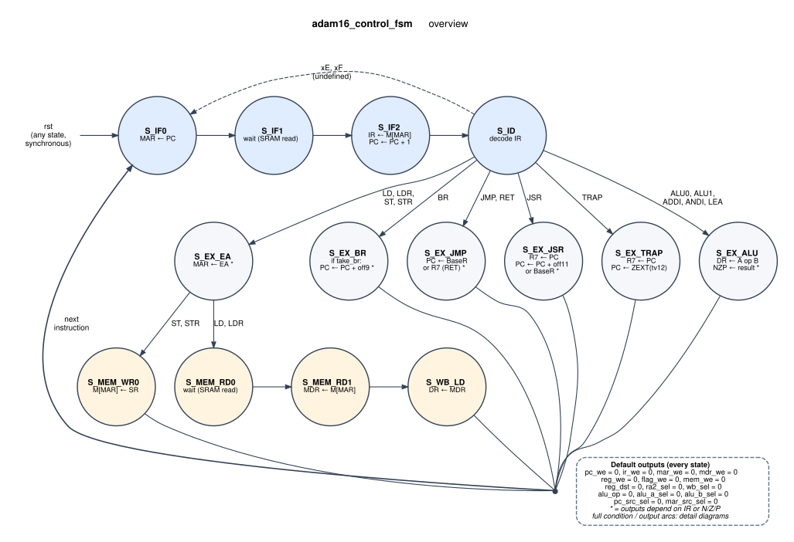
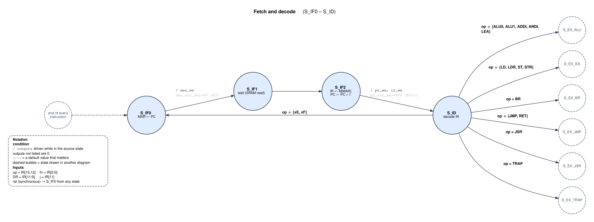
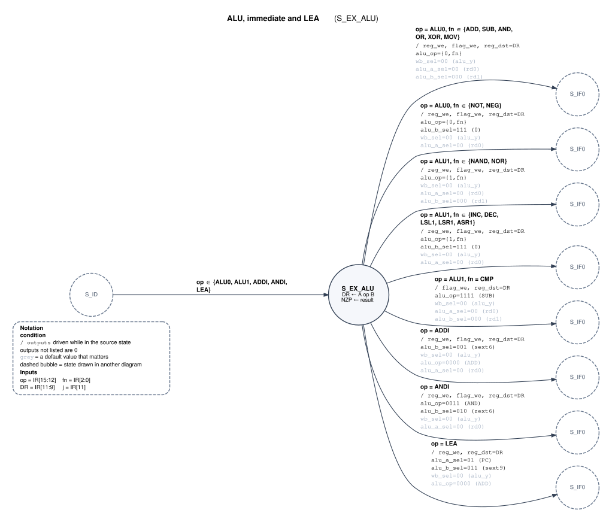
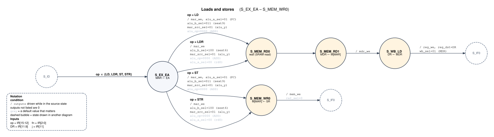
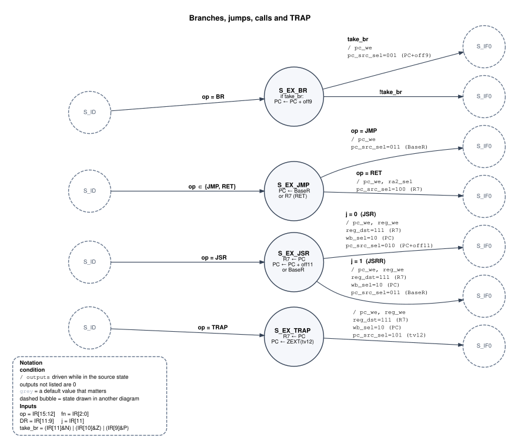

# 3. Control

`adam16_control_fsm` is a 14-state finite state machine. Every instruction starts at `S_IF0`, spends three cycles in fetch and one in decode, then takes one to four cycles on an execute path before returning to `S_IF0`. Its ports are on the [interface page](interfaces/adam16_control_fsm.md).

## Bubble diagrams

There are five diagrams: one overview, and four detail diagrams that between them contain every arc of the machine.

**How they are kept correct.** All five, and all three tables further down, are generated from one specification, [`docs/tools/fsm_spec.py`](tools/fsm_spec.py). `make -C docs check` expands that spec into a trace for every opcode × `IR[11:9]` × funct × {N, Z, P} combination: 8,192 instructions, 52,224 clock cycles, with `IR[8:3]` random. It then replays them against `rtl/adam16_control_fsm.sv` in simulation, comparing the state and all 15 outputs on every cycle (`tb/tb_control_fsm_spec.sv`). If you change the RTL, change the spec to match. The check fails until the two agree.

### Notation

The detail diagrams follow ECE551 conventions:

| Element | Meaning |
|---|---|
| Bubble | A state, with the register transfer that happens on the clock edge that *ends* it |
| **condition** | When this arc is taken, written over the SM inputs (below). No condition means always |
| `/ outputs` | The outputs the FSM drives *while in the arc's source state* when the condition holds. Single-bit outputs are listed by name when 1; multi-bit outputs as `name=value (meaning)` |
| Unlisted output | 0. Every output defaults to 0 every cycle, which is exactly how the RTL is written |
| Grey output (in the diagrams) | Listed at its default 0 because the value matters there: for example `mar_src_sel=00` in `S_IF0` is what makes MAR ← PC |
| Dashed bubble | A state drawn in full in another diagram (connector) |
| `rst` | Synchronous: forces `S_IF0` on the next edge from any state |

SM inputs: `op = IR[15:12]`, `fn = IR[2:0]`, `DR = IR[11:9]`, `j = IR[11]`, and `take_br = (IR[11]&N) | (IR[10]&Z) | (IR[9]&P)`. IR doesn't change between the edge that ends `S_IF2` and the next `S_IF2`, so in an execute state only the opcodes that lead there can occur.

### Overview

States and next-state conditions only. A `*` marks a state whose outputs depend on IR or the flags; the detail diagrams show how.



### Fetch and decode

`S_IF0`–`S_IF2` take three cycles because the memory address goes through MAR (see [memory interface](04_memory.md#protocol)). `S_ID` produces no outputs; it only picks the execute path.



### ALU, immediate and LEA

One state, eight cases. The cases differ in the ALU operation, the B operand, and whether the register file and the flags are written. CMP writes the flags but not DR (its ALU result is a signed −1/0/+1 compare), and LEA writes DR but not the flags.



### Loads and stores

`S_EX_EA` computes the address in the ALU and loads it into MAR: PC-relative for LD/ST, base + offset for LDR/STR. Loads then wait a cycle for the memory, latch MDR, and write the register. A store writes memory in one cycle; its data comes from register-file port 1, which `ra1_sel = 01` points at `R[IR[11:9]]`.



### Branches, jumps, calls and TRAP

Each takes a single execute cycle. JSR, JSRR and TRAP write the return address (PC†, already incremented in `S_IF2`) into R7 on the same edge that loads the new PC.



## States

The state register is 5 bits, binary encoded in this order. Synthesis tools may re-encode it (Vivado's FSM extraction often picks one-hot). Codes 14–31 are unreachable, and the RTL's `default` branch sends them back to `S_IF0`.

<!-- BEGIN GENERATED: fsm-states -->
| State | Code | Phase | Register transfer (on the closing edge) | Next state |
|---|---|---|---|---|
| `S_IF0` | 0 | fetch | MAR ← PC | `S_IF1` |
| `S_IF1` | 1 | fetch | — (memory reads M[MAR]) | `S_IF2` |
| `S_IF2` | 2 | fetch | IR ← M[MAR], PC ← PC + 1 | `S_ID` |
| `S_ID` | 3 | decode | decode IR | by opcode ([decode table](#decode-next-state-from-s_id)) |
| `S_EX_ALU` | 4 | execute | DR ← A op B; N Z P ← f(result). CMP writes flags only; LEA writes DR only | `S_IF0` |
| `S_EX_EA` | 5 | execute | MAR ← EA: PC† + SEXT(off9) for LD/ST, BaseR + SEXT(off6) for LDR/STR | `S_MEM_RD0` if LD/LDR, `S_MEM_WR0` if ST/STR |
| `S_MEM_RD0` | 6 | memory | — (memory reads M[MAR]) | `S_MEM_RD1` |
| `S_MEM_RD1` | 7 | memory | MDR ← M[MAR] | `S_WB_LD` |
| `S_WB_LD` | 8 | memory | DR ← MDR | `S_IF0` |
| `S_MEM_WR0` | 9 | memory | M[MAR] ← SR | `S_IF0` |
| `S_EX_BR` | 10 | execute | if take_br: PC ← PC† + SEXT(off9) | `S_IF0` |
| `S_EX_JMP` | 11 | execute | PC ← BaseR (JMP) or R7 (RET) | `S_IF0` |
| `S_EX_JSR` | 12 | execute | R7 ← PC†; PC ← PC† + SEXT(off11) (JSR) or BaseR (JSRR) | `S_IF0` |
| `S_EX_TRAP` | 13 | execute | R7 ← PC†; PC ← ZEXT(IR[11:0]) | `S_IF0` |
<!-- END GENERATED: fsm-states -->

### Decode: next state from `S_ID`

<!-- BEGIN GENERATED: fsm-decode -->
| Opcode `IR[15:12]` | Instructions | Next state |
|---|---|---|
| `0000`, `0001`, `0010`, `0011`, `1100` | ALU0, ALU1, ADDI, ANDI, LEA | `S_EX_ALU` |
| `0100`, `0101`, `1010`, `1011` | LD, ST, LDR, STR | `S_EX_EA` |
| `0110`, `1000` | JMP, RET | `S_EX_JMP` |
| `0111` | JSR | `S_EX_JSR` |
| `1001` | TRAP | `S_EX_TRAP` |
| `1101` | BR | `S_EX_BR` |
| `1110`, `1111` | xE, xF | `S_IF0` (undefined: a 4-cycle no-op) |
<!-- END GENERATED: fsm-decode -->

### Branch condition

```
take_br = (IR[11] & N) | (IR[10] & Z) | (IR[9] & P)
```

`IR[11:9]` is the instruction's `nzp` mask. With mask `111` the branch is always taken, because exactly one flag is always set (see [flags](02_datapath.md#condition-flags)). With mask `000` it is never taken, so `BR` with an empty mask is a 5-cycle no-op.

## Control-signal table

The same information as the detail diagrams, one row per arc. Codes match the [datapath select tables](02_datapath.md#muxes-and-select-codes).

- `1` = raised.
- A code (e.g. `011`) = that select value.
- `·` = left at the default 0, and it doesn't matter in that state.
- `DR` = `IR[11:9]`; `{0,fn}` = `{1'b0, IR[2:0]}`.

<!-- BEGIN GENERATED: fsm-control-table -->
| State | Case | `pc_we` | `ir_we` | `mar_we` | `mdr_we` | `reg_we` | `flag_we` | `mem_we` | `reg_dst` | `ra1_sel` | `wb_sel` | `alu_op` | `alu_a_sel` | `alu_b_sel` | `pc_src_sel` | `mar_src_sel` | Next |
|---|---|---|---|---|---|---|---|---|---|---|---|---|---|---|---|---|---|
| `S_IF0` |  | · | · | 1 | · | · | · | · | · | · | · | · | · | · | · | `00` | `S_IF1` |
| `S_IF1` |  | · | · | · | · | · | · | · | · | · | · | · | · | · | · | · | `S_IF2` |
| `S_IF2` |  | 1 | 1 | · | · | · | · | · | · | · | · | · | · | · | `000` | · | `S_ID` |
| `S_ID` | op ∈ {ALU0, ALU1, ADDI, ANDI, LEA} | · | · | · | · | · | · | · | · | · | · | · | · | · | · | · | `S_EX_ALU` |
|  | op ∈ {LD, LDR, ST, STR} | · | · | · | · | · | · | · | · | · | · | · | · | · | · | · | `S_EX_EA` |
|  | op = BR | · | · | · | · | · | · | · | · | · | · | · | · | · | · | · | `S_EX_BR` |
|  | op ∈ {JMP, RET} | · | · | · | · | · | · | · | · | · | · | · | · | · | · | · | `S_EX_JMP` |
|  | op = JSR | · | · | · | · | · | · | · | · | · | · | · | · | · | · | · | `S_EX_JSR` |
|  | op = TRAP | · | · | · | · | · | · | · | · | · | · | · | · | · | · | · | `S_EX_TRAP` |
|  | op ∈ {xE, xF} | · | · | · | · | · | · | · | · | · | · | · | · | · | · | · | `S_IF0` |
| `S_EX_ALU` | op = ALU0, fn ∈ {ADD, SUB, AND, OR, XOR, MOV} | · | · | · | · | 1 | 1 | · | `DR` | `00` | `00` | `{0,fn}` | `00` | `000` | · | · | `S_IF0` |
|  | op = ALU0, fn ∈ {NOT, NEG} | · | · | · | · | 1 | 1 | · | `DR` | · | `00` | `{0,fn}` | `00` | `111` | · | · | `S_IF0` |
|  | op = ALU1, fn ∈ {NAND, NOR} | · | · | · | · | 1 | 1 | · | `DR` | `00` | `00` | `{1,fn}` | `00` | `000` | · | · | `S_IF0` |
|  | op = ALU1, fn ∈ {INC, DEC, LSL1, LSR1, ASR1} | · | · | · | · | 1 | 1 | · | `DR` | · | `00` | `{1,fn}` | `00` | `111` | · | · | `S_IF0` |
|  | op = ALU1, fn = CMP | · | · | · | · | · | 1 | · | `DR` | `00` | `00` | `1111` | `00` | `000` | · | · | `S_IF0` |
|  | op = ADDI | · | · | · | · | 1 | 1 | · | `DR` | · | `00` | `0000` | `00` | `001` | · | · | `S_IF0` |
|  | op = ANDI | · | · | · | · | 1 | 1 | · | `DR` | · | `00` | `0011` | `00` | `010` | · | · | `S_IF0` |
|  | op = LEA | · | · | · | · | 1 | · | · | `DR` | · | `00` | `0000` | `01` | `011` | · | · | `S_IF0` |
| `S_EX_EA` | op = LD | · | · | 1 | · | · | · | · | · | · | · | `0000` | `01` | `011` | · | `01` | `S_MEM_RD0` |
|  | op = LDR | · | · | 1 | · | · | · | · | · | · | · | `0000` | `00` | `100` | · | `01` | `S_MEM_RD0` |
|  | op = ST | · | · | 1 | · | · | · | · | · | · | · | `0000` | `01` | `011` | · | `01` | `S_MEM_WR0` |
|  | op = STR | · | · | 1 | · | · | · | · | · | · | · | `0000` | `00` | `100` | · | `01` | `S_MEM_WR0` |
| `S_MEM_RD0` |  | · | · | · | · | · | · | · | · | · | · | · | · | · | · | · | `S_MEM_RD1` |
| `S_MEM_RD1` |  | · | · | · | 1 | · | · | · | · | · | · | · | · | · | · | · | `S_WB_LD` |
| `S_WB_LD` |  | · | · | · | · | 1 | · | · | `DR` | · | `01` | · | · | · | · | · | `S_IF0` |
| `S_MEM_WR0` |  | · | · | · | · | · | · | 1 | · | `01` | · | · | · | · | · | · | `S_IF0` |
| `S_EX_BR` | take_br | 1 | · | · | · | · | · | · | · | · | · | · | · | · | `001` | · | `S_IF0` |
|  | !take_br | · | · | · | · | · | · | · | · | · | · | · | · | · | · | · | `S_IF0` |
| `S_EX_JMP` | op = JMP | 1 | · | · | · | · | · | · | · | · | · | · | · | · | `011` | · | `S_IF0` |
|  | op = RET | 1 | · | · | · | · | · | · | · | `10` | · | · | · | · | `100` | · | `S_IF0` |
| `S_EX_JSR` | j = 0  (JSR) | 1 | · | · | · | 1 | · | · | `111` | · | `10` | · | · | · | `010` | · | `S_IF0` |
|  | j = 1  (JSRR) | 1 | · | · | · | 1 | · | · | `111` | · | `10` | · | · | · | `011` | · | `S_IF0` |
| `S_EX_TRAP` |  | 1 | · | · | · | 1 | · | · | `111` | · | `10` | · | · | · | `101` | · | `S_IF0` |
<!-- END GENERATED: fsm-control-table -->

## Moore or Mealy?

Every control output is a function of `(state, IR, N, Z, P)`. Two consequences:

1. **The timing behaves like a Moore machine.** IR and N/Z/P are registers inside the datapath, so no control output has a combinational path from any input of `adam16_core`, and in particular none from `mem_rdata`. Outputs settle shortly after each clock edge and stay stable for the rest of the cycle. Six outputs (`ir_we`, `mar_we`, `mdr_we`, `mem_we`, `wb_sel`, `mar_src_sel`) depend on the state alone.
2. **The notation is Mealy.** At the level of `adam16_control_fsm`, IR and the flags are inputs, and outputs that depend on inputs belong on arcs. That is why the detail diagrams write *condition / outputs*. A strictly Moore drawing would split `S_EX_ALU` into one state per case, `S_EX_BR` into taken / not-taken, and so on. The behaviour would be identical, with more states.
