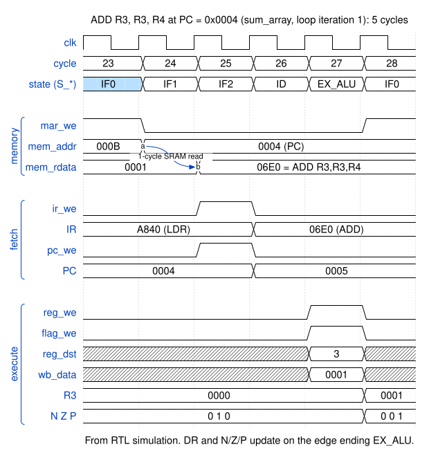
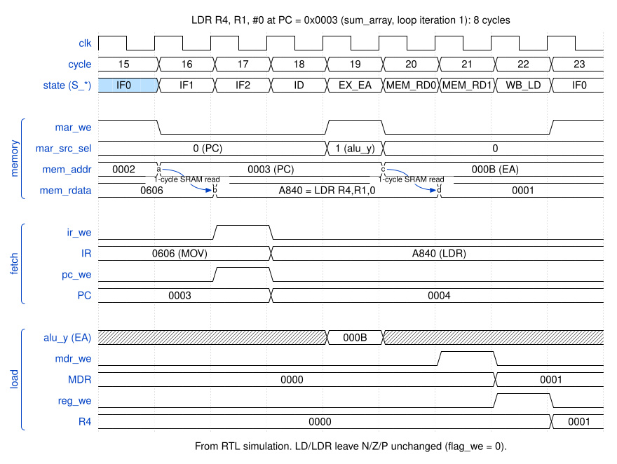
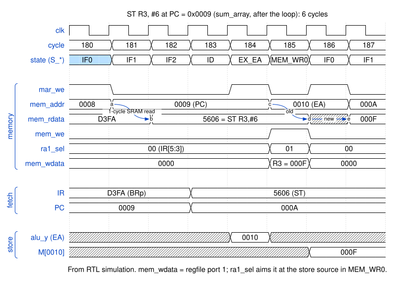

# 4. Memory interface

The core talks to one synchronous, single-port memory that holds both instructions and data, so it makes at most one access per cycle. The signals are listed in [port interfaces](interfaces/adam16_core.md#ports).

## Protocol

1. **The address comes from a register.** `mem_addr` is MAR, so it changes only on a clock edge and is stable for the whole cycle.
2. **Reads take one cycle.** `mem_rdata` during cycle *t + 1* equals `M[mem_addr during cycle t]`. Memory samples the address on every edge whether or not the core wants the data. The core picks the cycles in which it latches `mem_rdata` (into IR or MDR) and ignores it otherwise.
3. **Writes happen on the closing edge.** If `mem_we = 1` during a cycle, `M[mem_addr] ← mem_wdata` on the edge that ends it. That only happens in `S_MEM_WR0`. The address was loaded into MAR one edge earlier, and `mem_wdata` is `R[IR[11:9]]`, which has been stable since IR was loaded. So both are valid for the whole write cycle.
4. **Read-during-write doesn't matter.** `adam16_sram` returns the *old* contents during a write (read-first). The core never uses `mem_rdata` in the cycle after a write: `S_MEM_WR0` is always followed by `S_IF0`, which ignores it. So a replacement memory can use read-first, write-first or no-change behaviour.
5. **Exactly one cycle of latency is required.** A memory with an extra output register (two-cycle read, for example block RAM with its output register enabled) needs one more wait state in fetch (`S_IF1`) and in loads (`S_MEM_RD0`).

The cost of rule 1 is one wait state per memory access. The address is loaded into MAR on one edge, memory samples it on the next, and the data can be latched on the one after that. That's why fetch is three states:

| State | What happens on the closing edge |
|---|---|
| `S_IF0` | MAR ← PC |
| `S_IF1` | memory: `rdata ← M[PC]` |
| `S_IF2` | IR ← `rdata`, PC ← PC + 1 |

Loads follow the same pattern: `S_EX_EA` (MAR ← EA), `S_MEM_RD0` (memory reads), `S_MEM_RD1` (MDR ← rdata), and then one more state, `S_WB_LD`, to move MDR into the register file. [Execution timing](05_timing.md#where-the-cycles-go) looks at what it would take to remove these cycles.

## Timing diagrams

All three come from RTL simulation of the `sum_array` program (`fpga/mem/adam16_sum_array.mem`, the same program as testbench T12). The cycle numbers count from the first cycle after reset. Hatched regions are values that don't matter in that cycle; the arrows mark the one-cycle read latency.

### ALU instruction: `ADD R3, R3, R4` (5 cycles)

- **Cycle 23 (`S_IF0`).** MAR still holds `0x000B` from the previous LDR, so `mem_rdata` shows the stale `M[0x000B]`. The closing edge loads MAR with PC = `0x0004`.
- **Cycle 24 (`S_IF1`).** Memory samples address `0x0004`.
- **Cycle 25 (`S_IF2`).** The instruction `0x06E0` is on `mem_rdata`. The closing edge loads it into IR and increments PC.
- **Cycle 26 (`S_ID`).** IR is valid and the controller picks `S_EX_ALU`. Nothing is written.
- **Cycle 27 (`S_EX_ALU`).** R3 + R4 = `0x0001` reaches `wb_data`. The closing edge writes R3 and sets the flags from Z to P.

### Load: `LDR R4, R1, #0` (8 cycles)

- **Cycles 15–17.** Fetch, exactly as above.
- **Cycle 19 (`S_EX_EA`).** The ALU computes R1 + 0 = `0x000B`, and with `mar_src_sel = 01` the closing edge loads it into MAR.
- **Cycle 20 (`S_MEM_RD0`).** Memory samples `0x000B`.
- **Cycle 21 (`S_MEM_RD1`).** `M[0x000B] = 0x0001` is on `mem_rdata` and is latched into MDR.
- **Cycle 22 (`S_WB_LD`).** MDR is written to R4 through `wb_sel = 01`. `flag_we` stays 0: loads don't touch the condition codes in this ISA.

### Store: `ST R3, #6` (6 cycles)

- **Cycles 180–182.** Fetch. `mem_wdata` is just register-file read port 2, so it follows whatever register `IR[11:9]` names: R1 while IR still holds the previous BRp, then R3 once the ST is in IR (cycle 183).
- **Cycle 184 (`S_EX_EA`).** PC† + 6 = `0x0010` is loaded into MAR.
- **Cycle 185 (`S_MEM_WR0`).** `mem_we = 1`, so the closing edge writes `0x000F` to `M[0x0010]`.
- **Cycle 186 (`S_IF0`).** `mem_rdata` shows the read-first behaviour. The read sampled during the write cycle returns the *old* `M[0x0010]`, which was never initialised (X in simulation).
- **Cycle 187.** The new value `0x000F` appears, one cycle later. Nothing in the core consumes either of these reads.
