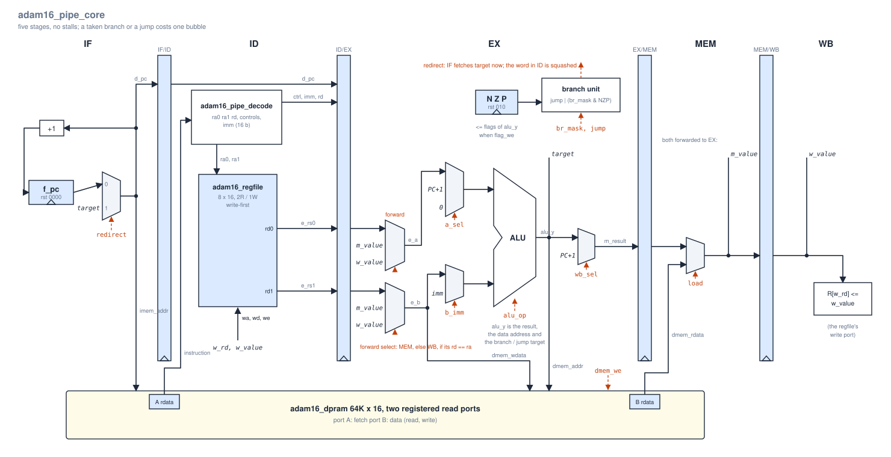

# 7. The pipelined core

`adam16_pipe_core` runs the same frozen ISA as the multicycle `adam16_core`, in a classic five-stage pipeline. Both cores are kept and both are tested the same way: the regression runs every program on the ISS and on each core and requires the same retire trace, instruction for instruction ([verification](08_verification.md)).

| | `adam16_core` (multicycle) | `adam16_pipe_core` (pipelined) |
|---|---|---|
| Instructions in flight | 1 | up to 5 |
| Cycles per instruction | 5, 6 (store), 8 (load) | 1, plus 1 after a taken branch or a jump |
| `sum_array` (35 instructions) | 191 cycles | **43 cycles** (4 to fill, 4 bubbles) |
| Stalls | — | none |
| Memory | one single-port RAM, `adam16_sram` | one dual-port RAM, `adam16_dpram`: port A fetches, port B reads and writes data |
| Memory ports on the core | `mem_addr`, `mem_wdata`, `mem_we`, `mem_rdata` | `imem_addr`, `imem_rdata`; `dmem_addr`, `dmem_wdata`, `dmem_we`, `dmem_rdata` |
| Register file | `adam16_regfile`, `BYPASS = 0` | `adam16_regfile`, `BYPASS = 1` (write-first) |
| Control | 14-state FSM | combinational decoder in ID, valid bits, a branch unit in EX |
| Debug outputs | PC, IR, ALU output, flags | the instruction in WB: PC, IR, result, flags after it |

Across 2000 random programs (`make regress RANDOM_N=2000`) the pipeline averages **1.16 cycles per instruction**, against 5.55 for the multicycle core.

## The stages

| Stage | Does | Pipeline register it fills |
|---|---|---|
| **IF** | Presents `imem_addr` to port A: `target` if EX is redirecting, else `f_pc`. `f_pc ← imem_addr + 1`. | IF/ID: `d_valid`, `d_pc`. The instruction word is port A's own read register (`imem_rdata`) |
| **ID** | Decodes (`adam16_pipe_decode`) and reads two registers. The register file is write-first, so the value WB is writing this cycle is the value read. | ID/EX: `e_valid`, `e_pc`, `e_ir`, the decoded controls and `imm`, `e_rs0`, `e_rs1` |
| **EX** | Forwards the operands, runs the ALU, presents `dmem_addr`, `dmem_wdata`, `dmem_we` to port B, updates N Z P, and decides `redirect`. | EX/MEM: `m_result` (`alu_y`, or PC+1 for JSR / JSRR / TRAP), `m_load`, destination. Load data: port B's own read register (`dmem_rdata`) |
| **MEM** | `m_value = m_load ? dmem_rdata : m_result`. Nothing else: memory was already accessed. | MEM/WB: `w_value`, destination |
| **WB** | Writes `R[w_rd] ← w_value`. | — |

The ALU output is everything an instruction computes: the result, the data address and the branch or jump target ([decode table](#decode)). There is no separate address adder or branch adder.

Every pipeline register has a clock enable (`ce`), so the core can be single-stepped, and only the valid bits, `f_pc` and N Z P are reset. The other pipeline registers need no reset: an invalid stage can't write a register, the flags or memory, and can't redirect.

## Memory

The dual-port RAM removes the structural hazard between fetch and data access: port A reads an instruction every cycle while port B serves a load or store. It is still **one** memory, so programs and data share one 64K-word address space, as on the multicycle core and the ISS.

Both ports have a registered read, and both read registers are pipeline registers:

- **Port A** is the IF/ID instruction register. The address goes out in IF and the word is there in ID.
- **Port B** is part of EX/MEM. The address goes out in EX and the load data is there in MEM, a stage earlier than in the textbook pipeline, which reads memory *during* MEM.

Every load and store happens on the edge that ends its EX, so memory sees them in program order.

## Hazards

### Data hazards: forwarding, no stalls

An instruction in EX gets each register operand from the youngest older instruction that writes that register:

| The producer is | Ahead by | The value comes from | Path |
|---|---|---|---|
| in MEM | 1 | `m_value`: the ALU result, PC+1, or for a load the word on `dmem_rdata` | MEM → EX |
| in WB | 2 | `w_value` | WB → EX |
| writing in WB while the consumer is in ID | 3 | the register file (write-first) | WB → ID |
| older | 4+ | the register file | — |

MEM takes priority over WB, since it holds the younger instruction. The compare uses the decoder's `ra0` / `ra1` even when the instruction doesn't use that operand. A needless forward is harmless, because the value is ignored.

**Loads need no stall.** Port B captures the loaded word on the edge that ends the load's EX, so the word is on `dmem_rdata` while the load is in MEM. That is the same cycle in which an ALU result would be in MEM, and it is forwarded the same way. The price is a longer combinational path in that cycle (see [timing](#timing)). The textbook five-stage pipeline reads memory during MEM and has to stall one cycle for a load followed by an instruction that uses its value.

**Stores** take their data through the same forwarding as an ALU operand (`e_b`), so a store right after the instruction that produces its data, even a load, needs nothing special. A load right after a store to the same address reads the new value, because the store wrote it on the previous edge.

**Flags** change on the edge that ends EX, and BR reads them in EX. So a branch right after the CMP (or any flag-setting instruction) that it tests sees the new flags with no forwarding. Loads, LEA, JSR and TRAP leave the flags alone, as the ISA says.

### Control hazards: one bubble per taken branch or jump

Fetch assumes fall-through: it fetches PC+1 every cycle. Branches and jumps are resolved in EX. When EX holds a taken BR, or a JMP, JSR, JSRR, RET or TRAP, `redirect` is 1 and in that same cycle:

1. port A fetches `target` instead of `f_pc` (`imem_addr = redirect ? target : f_pc`), and
2. the instruction in ID, which is the one at PC+1 and the wrong path, is squashed (`e_valid ← 0`).

| Instruction | Extra cycles |
|---|---|
| Untaken branch, NOP | 0 |
| Taken branch | 1 |
| JMP, RET, JSR, JSRR, TRAP | 1 |

A squashed instruction never reaches EX, so it can't change anything. Only one instruction is ever on the wrong path, because the target goes out to memory in the same cycle the branch resolves.

### What the pipeline does not do

- **Self-modifying code.** When a store is in EX, the next two instruction words have already been fetched (one is in ID, and port A reads the other on the same edge as the store writes). A store to either of those two words is not seen by the instructions about to execute. The multicycle core and the ISS do see it. No program in this repository writes its own code. If one must, three instructions between the store and the code it changes are enough.
- **HALT.** As on the multicycle core, `TRAP x025` is an ordinary TRAP: the core jumps to `0x0025` and carries on. The testbench and the ISS stop when it retires.

## Decode

`adam16_pipe_decode` is the ID-stage decoder. The table is generated from its specification, `docs/tools/pipe_decode_spec.py`, and `make -C docs check` compares the RTL against that specification for all 65536 instruction words.

<!-- BEGIN GENERATED: pipe-decode -->
| Instruction | Reads | rd | reg_we | flag_we | mem_we | wb_sel | alu_op | a | b | br_mask | jump | ALU output is |
|---|---|---|---|---|---|---|---|---|---|---|---|---|
| ADD SUB AND OR XOR NAND NOR | SR1, SR2 | DR | 1 | 1 | 0 | ALU | {IR[12], funct} | R[ra0] | R[ra1] | 0 | 0 | R[SR1] op R[SR2] |
| NOT MOV NEG INC DEC LSL1 LSR1 ASR1 | SR1 | DR | 1 | 1 | 0 | ALU | {IR[12], funct} | R[ra0] | R[ra1] | 0 | 0 | op R[SR1] |
| CMP | SR1, SR2 | · | 0 | 1 | 0 | · | {IR[12], funct} | R[ra0] | R[ra1] | 0 | 0 | -1 / 0 / +1: flags only |
| ADDI | SR1 | DR | 1 | 1 | 0 | ALU | ADD | R[ra0] | SEXT(imm6) | 0 | 0 | R[SR1] + imm |
| ANDI | SR1 | DR | 1 | 1 | 0 | ALU | AND | R[ra0] | ZEXT(imm6) | 0 | 0 | R[SR1] & imm |
| LD | — | DR | 1 | 0 | 0 | load | ADD | PC+1 | SEXT(off9) | 0 | 0 | address |
| ST | SR (data) | · | 0 | 0 | 1 | · | ADD | PC+1 | SEXT(off9) | 0 | 0 | address |
| LDR | Base | DR | 1 | 0 | 0 | load | ADD | R[ra0] | SEXT(off6) | 0 | 0 | address |
| STR | Base, SR (data) | · | 0 | 0 | 1 | · | ADD | R[ra0] | SEXT(off6) | 0 | 0 | address |
| LEA | — | DR | 1 | 0 | 0 | ALU | ADD | PC+1 | SEXT(off9) | 0 | 0 | result |
| BR | — | · | 0 | 0 | 0 | · | ADD | PC+1 | SEXT(off9) | IR[11:9] | 0 | target, taken if IR[11:9] & NZP |
| JMP | Base | · | 0 | 0 | 0 | · | MOV | R[ra0] | R[ra1] | 0 | 1 | target |
| RET | R7 | · | 0 | 0 | 0 | · | MOV | R[ra0] | R[ra1] | 0 | 1 | target |
| JSR | — | R7 | 1 | 0 | 0 | PC+1 | ADD | PC+1 | SEXT(off11) | 0 | 1 | target; R7 <- PC+1 |
| JSRR | Base | R7 | 1 | 0 | 0 | PC+1 | MOV | R[ra0] | R[ra1] | 0 | 1 | target (old R7); R7 <- PC+1 |
| TRAP | — | R7 | 1 | 0 | 0 | PC+1 | ADD | 0 | ZEXT(tv12) | 0 | 1 | target; R7 <- PC+1 |
| undefined 0xE, 0xF | — | · | 0 | 0 | 0 | · | ADD | R[ra0] | R[ra1] | 0 | 0 | nothing |
<!-- END GENERATED: pipe-decode -->

`a` is `R[ra0]`, `PC+1` or `0`, chosen by `a_sel`; `b` is `R[ra1]` or `imm`, chosen by `b_imm`. `wb_sel` chooses what MEM passes on to be written: the ALU output, PC+1 (the link for JSR, JSRR and TRAP) or the load data. JSRR reads its base register before writing R7, so `JSRR R7` jumps to the old R7, as the ISA requires.

## Cycle by cycle: `sum_array`

What every stage holds in every cycle of `sum_array` (`sw/tests/sum_array.asm`), taken from the RTL by `docs/tools/gen_pipeview.py`. `·` is an empty stage (a bubble). A ~~struck-through~~ instruction in ID is being squashed this cycle; it moves into EX as a bubble.

<!-- BEGIN GENERATED: pipeview -->
| Cycle | IF (address) | ID | EX | MEM | WB |
|---|---|---|---|---|---|
| 1 | 00 | · | · | · | · |
| 2 | 01 | 00 LEA R1, 0x000B | · | · | · |
| 3 | 02 | 01 ADDI R2, R0, 5 | 00 LEA R1, 0x000B | · | · |
| 4 | 03 | 02 MOV R3, R0 | 01 ADDI R2, R0, 5 | 00 LEA R1, 0x000B | · |
| 5 | 04 | 03 LDR R4, R1, 0 | 02 MOV R3, R0 | 01 ADDI R2, R0, 5 | 00 LEA R1, 0x000B |
| 6 | 05 | 04 ADD R3, R3, R4 | 03 LDR R4, R1, 0 | 02 MOV R3, R0 | 01 ADDI R2, R0, 5 |
| 7 | 06 | 05 INC R1, R1 | 04 ADD R3, R3, R4 | 03 LDR R4, R1, 0 | 02 MOV R3, R0 |
| 8 | 07 | 06 DEC R2, R2 | 05 INC R1, R1 | 04 ADD R3, R3, R4 | 03 LDR R4, R1, 0 |
| 9 | 08 | 07 CMP R2, R0 | 06 DEC R2, R2 | 05 INC R1, R1 | 04 ADD R3, R3, R4 |
| 10 | 09 | 08 BRp 0x0003 | 07 CMP R2, R0 | 06 DEC R2, R2 | 05 INC R1, R1 |
| 11 | 03 ← target | ~~09 ST R3, 0x0010~~ | 08 BRp 0x0003 **→ redirect** | 07 CMP R2, R0 | 06 DEC R2, R2 |
| 12 | 04 | 03 LDR R4, R1, 0 | · | 08 BRp 0x0003 | 07 CMP R2, R0 |
| 13 | 05 | 04 ADD R3, R3, R4 | 03 LDR R4, R1, 0 | · | 08 BRp 0x0003 |
| 14 | 06 | 05 INC R1, R1 | 04 ADD R3, R3, R4 | 03 LDR R4, R1, 0 | · |
| 15 | 07 | 06 DEC R2, R2 | 05 INC R1, R1 | 04 ADD R3, R3, R4 | 03 LDR R4, R1, 0 |
| 16 | 08 | 07 CMP R2, R0 | 06 DEC R2, R2 | 05 INC R1, R1 | 04 ADD R3, R3, R4 |
| 17 | 09 | 08 BRp 0x0003 | 07 CMP R2, R0 | 06 DEC R2, R2 | 05 INC R1, R1 |
| 18 | 03 ← target | ~~09 ST R3, 0x0010~~ | 08 BRp 0x0003 **→ redirect** | 07 CMP R2, R0 | 06 DEC R2, R2 |
| 19 | 04 | 03 LDR R4, R1, 0 | · | 08 BRp 0x0003 | 07 CMP R2, R0 |
| 20 | 05 | 04 ADD R3, R3, R4 | 03 LDR R4, R1, 0 | · | 08 BRp 0x0003 |
| 21 | 06 | 05 INC R1, R1 | 04 ADD R3, R3, R4 | 03 LDR R4, R1, 0 | · |
| 22 | 07 | 06 DEC R2, R2 | 05 INC R1, R1 | 04 ADD R3, R3, R4 | 03 LDR R4, R1, 0 |
| 23 | 08 | 07 CMP R2, R0 | 06 DEC R2, R2 | 05 INC R1, R1 | 04 ADD R3, R3, R4 |
| 24 | 09 | 08 BRp 0x0003 | 07 CMP R2, R0 | 06 DEC R2, R2 | 05 INC R1, R1 |
| 25 | 03 ← target | ~~09 ST R3, 0x0010~~ | 08 BRp 0x0003 **→ redirect** | 07 CMP R2, R0 | 06 DEC R2, R2 |
| 26 | 04 | 03 LDR R4, R1, 0 | · | 08 BRp 0x0003 | 07 CMP R2, R0 |
| 27 | 05 | 04 ADD R3, R3, R4 | 03 LDR R4, R1, 0 | · | 08 BRp 0x0003 |
| 28 | 06 | 05 INC R1, R1 | 04 ADD R3, R3, R4 | 03 LDR R4, R1, 0 | · |
| 29 | 07 | 06 DEC R2, R2 | 05 INC R1, R1 | 04 ADD R3, R3, R4 | 03 LDR R4, R1, 0 |
| 30 | 08 | 07 CMP R2, R0 | 06 DEC R2, R2 | 05 INC R1, R1 | 04 ADD R3, R3, R4 |
| 31 | 09 | 08 BRp 0x0003 | 07 CMP R2, R0 | 06 DEC R2, R2 | 05 INC R1, R1 |
| 32 | 03 ← target | ~~09 ST R3, 0x0010~~ | 08 BRp 0x0003 **→ redirect** | 07 CMP R2, R0 | 06 DEC R2, R2 |
| 33 | 04 | 03 LDR R4, R1, 0 | · | 08 BRp 0x0003 | 07 CMP R2, R0 |
| 34 | 05 | 04 ADD R3, R3, R4 | 03 LDR R4, R1, 0 | · | 08 BRp 0x0003 |
| 35 | 06 | 05 INC R1, R1 | 04 ADD R3, R3, R4 | 03 LDR R4, R1, 0 | · |
| 36 | 07 | 06 DEC R2, R2 | 05 INC R1, R1 | 04 ADD R3, R3, R4 | 03 LDR R4, R1, 0 |
| 37 | 08 | 07 CMP R2, R0 | 06 DEC R2, R2 | 05 INC R1, R1 | 04 ADD R3, R3, R4 |
| 38 | 09 | 08 BRp 0x0003 | 07 CMP R2, R0 | 06 DEC R2, R2 | 05 INC R1, R1 |
| 39 | 0A | 09 ST R3, 0x0010 | 08 BRp 0x0003 | 07 CMP R2, R0 | 06 DEC R2, R2 |
| 40 | 0B | 0A HALT | 09 ST R3, 0x0010 | 08 BRp 0x0003 | 07 CMP R2, R0 |
| 41 | 25 ← target | ~~0B SUB R0, R0, R0~~ | 0A HALT **→ redirect** | 09 ST R3, 0x0010 | 08 BRp 0x0003 |
| 42 | 26 | 25 ADD R0, R0, R0 | · | 0A HALT | 09 ST R3, 0x0010 |
| 43 | 27 | 26 ADD R0, R0, R0 | 25 ADD R0, R0, R0 | · | 0A HALT (retires: end) |
<!-- END GENERATED: pipeview -->

The first instruction retires in cycle 5. After that one instruction retires every cycle, except right after each of the four taken `BRp`. `HALT` retires in cycle 43.

- **Load-use:** `LDR R4, R1, 0` is followed straight away by `ADD R3, R3, R4`. In the cycle the ADD is in EX, the LDR is in MEM and R4 comes from `dmem_rdata`.
- **Compare and branch:** `CMP R2, R0` sets the flags as it leaves EX, and `BRp loop` reads them in the next cycle.

## Timing

No synthesis results are given here. The longest paths are combinational chains that end in EX, the price of having no stalls:

1. **Port B read register → forward mux → ALU → port B address.** A load followed by a load or store that uses the loaded value as its base.
2. **Port B read register → forward mux → ALU → `target` → port A address.** A load followed by `JMP` / `JSRR` / `RET` through the loaded register.
3. **N Z P → branch unit → `redirect` → port A address mux**, and **→ `e_valid`**.

To shorten them, two options cost one cycle each:

- Register `redirect` and `target` (two bubbles per taken branch instead of one).
- Read data memory during MEM, the textbook way, which adds a one-cycle stall after a load whose value the next instruction uses.

## Retire record

For verification the core carries what each instruction did down to WB (`rt_valid`, `rt_pc`, `rt_ir`, register write, memory write, flags after). `tb/tb_program.sv` logs it in the format of the ISS. The fields that nothing else uses are removed by synthesis. The multicycle core has no such signals, so the testbench reconstructs the same record from its FSM and datapath.
