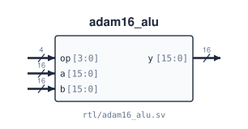

# `adam16_alu`

**Source:** `rtl/adam16_alu.sv` · **Instantiated in:** `adam16_datapath` (as `alu0`), `adam16_pipe_core` (as `alu`)

A purely combinational 16-bit ALU with 16 operations in two groups of eight. It has no clock, no state and no flag outputs: the datapath derives N/Z/P from the write-back value.



## Ports

| Signal | Dir | Width | Type | Reset | Description |
|---|---|---|---|---|---|
| `op` | in | 4 | data | — | Operation `{group, funct}`: `op[3]` picks ALU0 (0) or ALU1 (1), `op[2:0]` is the funct |
| `a` | in | 16 | data | — | Operand A |
| `b` | in | 16 | data | — | Operand B. Ignored by the one-operand operations |
| `y` | out | 16 | comb | — | Result |

All three inputs have combinational paths to `y`.

## Operations

For ALU0/ALU1 instructions the controller drives `op = {IR[12], IR[2:0]}`, because the two opcodes differ only in bit 12. Other instructions use ADD (`0000`) or AND (`0011`).

| `op` | Name | `y` | Instructions |
|---|---|---|---|
| `0000` | ADD | `a + b` | ADD, ADDI, LEA, every load/store address |
| `0001` | SUB | `a − b` | SUB |
| `0010` | NOT | `~a` | NOT |
| `0011` | AND | `a & b` | AND, ANDI |
| `0100` | OR | `a \| b` | OR |
| `0101` | XOR | `a ^ b` | XOR |
| `0110` | PASS | `a` | MOV |
| `0111` | NEG | `0 − a` | NEG |
| `1000` | NAND | `~(a & b)` | NAND |
| `1001` | NOR | `~(a \| b)` | NOR |
| `1010` | INC | `a + 1` | INC |
| `1011` | DEC | `a − 1` | DEC |
| `1100` | LSL1 | `a << 1` | LSL1 |
| `1101` | LSR1 | `a >> 1`, zero fill | LSR1 |
| `1110` | ASR1 | `a >>> 1`, sign fill | ASR1 |
| `1111` | CMP | signed compare: `−1` if a < b, `0` if a = b, `+1` if a > b | CMP (the controller suppresses the register write; the flags see the result) |

Arithmetic wraps modulo 2<sup>16</sup>, and there is no carry or overflow output. CMP doesn't need one: it compares rather than subtracts, so it is correct for every pair of 16-bit signed values, including the ones where `a − b` would overflow (`0x7FFF` vs `0x8000`, `0x8000` vs `0x0001`).

## Instantiation

<!-- BEGIN GENERATED: instantiation -->
```systemverilog
adam16_alu u_adam16_alu (
  .op (op),  // in   4
  .a  (a),   // in  16
  .b  (b),   // in  16
  .y  (y)    // out 16
);
```
<!-- END GENERATED: instantiation -->
