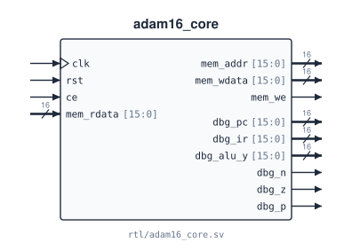

# `adam16_core`

**Source:** `rtl/adam16_core.sv` · **Instantiated in:** `basys3_top` (as `u_cpu`), `tb_adam16`, `tb_adam16_gate` · **Contains:** `adam16_control_fsm` (`u_ctrl`), `adam16_datapath` (`u_dp`)

The multicycle processor (5–8 cycles per instruction). It has a single memory port: synchronous, word-addressed, with a one-cycle read latency, shared by instruction fetch and data access. It also has a set of debug outputs. Inside, it only wires the controller to the datapath and taps the debug signals; there is no logic of its own.



## Ports

| Signal | Dir | Width | Type | Reset | Description |
|---|---|---|---|---|---|
| `clk` | in | 1 | clock | — | Core clock. Every register in the core updates on the rising edge |
| `rst` | in | 1 | reset | — | One rising edge with `rst = 1` (`ce` is ignored): FSM → `S_IF0`; PC, IR, MAR, MDR, R0–R7 → `0x0000`; N Z P → `0 1 0` |
| `ce` | in | 1 | data | — | Clock enable. The core advances one cycle on each rising edge with `ce = 1` and holds otherwise. Drive the memory's `en` from the same signal. Tie to 1 to run at full speed; `basys3_top` drives it from the step button |
| `mem_rdata` | in | 16 | data | — | Read data. Must equal `M[mem_addr]` as presented during the *previous* cycle. Latched into IR in `S_IF2` and into MDR in `S_MEM_RD1`; ignored in every other state |
| `mem_addr` | out | 16 | reg | `0x0000` | Memory address (= MAR). Changes only on edges that end `S_IF0` or `S_EX_EA` |
| `mem_wdata` | out | 16 | comb | — | Write data = register-file read port 1, which the controller points at the store source `R[IR[11:9]]` in `S_MEM_WR0`. Only meaningful while `mem_we = 1` |
| `mem_we` | out | 1 | comb | — | Write enable: 1 only in `S_MEM_WR0`. Decoded from the state register alone. Memory writes `M[mem_addr] ← mem_wdata` on the edge that ends that cycle |
| `dbg_pc` | out | 16 | reg | `0x0000` | PC (= PC† from `S_ID` onward) |
| `dbg_ir` | out | 16 | reg | `0x0000` | IR |
| `dbg_alu_y` | out | 16 | comb | — | ALU output. Meaningful only in `S_EX_ALU` and `S_EX_EA` |
| `dbg_n` | out | 1 | reg | `0` | N flag |
| `dbg_z` | out | 1 | reg | `1` | Z flag |
| `dbg_p` | out | 1 | reg | `0` | P flag |

## Timing

- **Memory protocol.** One access per cycle. Reads take one cycle; writes happen on the edge that ends `S_MEM_WR0`. Details and waveforms: [memory interface](../04_memory.md).
- **No input-to-output combinational paths.** No input of `adam16_core` reaches an output without passing through a register. `mem_rdata` only goes into IR and MDR, and every control signal depends only on the state, IR and N/Z/P, which are all registers. `mem_we` and `mem_wdata` are combinational, but only from registers.
- **Cycles per instruction:** 5 (ALU, branch, jump, call, TRAP), 6 (store), 8 (load), 4 (undefined opcode). See [execution timing](../05_timing.md).

## Connections

Every port and every internal net, with the instance pin or logic that drives it and the ones that read it. Generated from the RTL.

<!-- BEGIN GENERATED: connections -->
| Net | Width | Driven by | Read by |
|---|---|---|---|
| `clk` | 1 | port `clk` | `u_ctrl.clk`, `u_dp.clk` |
| `rst` | 1 | port `rst` | `u_ctrl.rst`, `u_dp.rst` |
| `ce` | 1 | port `ce` | `u_ctrl.ce`, `u_dp.ce` |
| `mem_rdata` | 16 | port `mem_rdata` | `u_dp.mem_rdata` |
| `mem_addr` | 16 | `u_dp.mem_addr` | port `mem_addr` |
| `mem_wdata` | 16 | `u_dp.mem_wdata` | port `mem_wdata` |
| `mem_we` | 1 | `u_ctrl.mem_we` | port `mem_we` |
| `dbg_pc` | 16 | `assign` from `pc` | port `dbg_pc` |
| `dbg_ir` | 16 | `assign` from `ir` | port `dbg_ir` |
| `dbg_alu_y` | 16 | `assign` from `alu_y_w` | port `dbg_alu_y` |
| `dbg_n` | 1 | `assign` from `N` | port `dbg_n` |
| `dbg_z` | 1 | `assign` from `Z` | port `dbg_z` |
| `dbg_p` | 1 | `assign` from `P` | port `dbg_p` |
| `ir` | 16 | `u_dp.ir` | `u_ctrl.ir`, `assign dbg_ir` |
| `N` | 1 | `u_dp.N` | `u_ctrl.N`, `assign dbg_n` |
| `Z` | 1 | `u_dp.Z` | `u_ctrl.Z`, `assign dbg_z` |
| `P` | 1 | `u_dp.P` | `u_ctrl.P`, `assign dbg_p` |
| `pc_we` | 1 | `u_ctrl.pc_we` | `u_dp.pc_we` |
| `ir_we` | 1 | `u_ctrl.ir_we` | `u_dp.ir_we` |
| `mar_we` | 1 | `u_ctrl.mar_we` | `u_dp.mar_we` |
| `mdr_we` | 1 | `u_ctrl.mdr_we` | `u_dp.mdr_we` |
| `reg_we` | 1 | `u_ctrl.reg_we` | `u_dp.reg_we` |
| `flag_we` | 1 | `u_ctrl.flag_we` | `u_dp.flag_we` |
| `reg_dst` | 3 | `u_ctrl.reg_dst` | `u_dp.reg_dst` |
| `ra1_sel` | 2 | `u_ctrl.ra1_sel` | `u_dp.ra1_sel` |
| `wb_sel` | 2 | `u_ctrl.wb_sel` | `u_dp.wb_sel` |
| `alu_op` | 4 | `u_ctrl.alu_op` | `u_dp.alu_op` |
| `alu_a_sel` | 2 | `u_ctrl.alu_a_sel` | `u_dp.alu_a_sel` |
| `alu_b_sel` | 3 | `u_ctrl.alu_b_sel` | `u_dp.alu_b_sel` |
| `pc_src_sel` | 3 | `u_ctrl.pc_src_sel` | `u_dp.pc_src_sel` |
| `mar_src_sel` | 2 | `u_ctrl.mar_src_sel` | `u_dp.mar_src_sel` |
| `pc` | 16 | `u_dp.pc` | `assign dbg_pc` |
| `alu_y_w` | 16 | `u_dp.alu_y_o` | `assign dbg_alu_y` |
<!-- END GENERATED: connections -->

## Instantiation

<!-- BEGIN GENERATED: instantiation -->
```systemverilog
adam16_core u_adam16_core (
  .clk       (clk),        // in   1
  .rst       (rst),        // in   1
  .ce        (ce),         // in   1
  .mem_rdata (mem_rdata),  // in  16
  .mem_addr  (mem_addr),   // out 16
  .mem_wdata (mem_wdata),  // out 16
  .mem_we    (mem_we),     // out  1
  .dbg_pc    (dbg_pc),     // out 16
  .dbg_ir    (dbg_ir),     // out 16
  .dbg_alu_y (dbg_alu_y),  // out 16
  .dbg_n     (dbg_n),      // out  1
  .dbg_z     (dbg_z),      // out  1
  .dbg_p     (dbg_p)       // out  1
);
```
<!-- END GENERATED: instantiation -->
