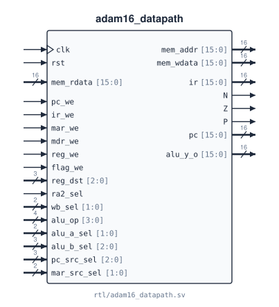

# `adam16_datapath`

**Source:** `rtl/adam16_datapath.sv` · **Instantiated in:** `adam16_core` (as `u_dp`) · **Contains:** `adam16_regfile` (`rf`), `adam16_alu` (`alu0`) · **Imports:** `adam16_isa`

Everything the controller steers: PC, IR, MAR, MDR, the N/Z/P flags, the register file, the ALU, and the muxes between them. It slices fixed IR fields (register numbers, immediates) but never decodes the opcode. Every opcode-dependent choice arrives on a control input.



The internal structure is in [Datapath](../02_datapath.md), with the full diagram and every mux select code.

## Ports

| Signal | Dir | Width | Type | Reset | Description |
|---|---|---|---|---|---|
| `clk` | in | 1 | clock | — | Clock for PC, IR, MAR, MDR, flags and register file |
| `rst` | in | 1 | reset | — | PC, IR, MAR, MDR, R0–R7 → `0x0000`; N Z P → `0 1 0` |
| `ce` | in | 1 | data | — | Clock enable for every register here and in the register file. With `ce = 0` nothing changes |
| `mem_rdata` | in | 16 | data | — | Memory read data, loaded into IR when `ir_we` and into MDR when `mdr_we` |
| `mem_addr` | out | 16 | reg | `0x0000` | = MAR |
| `mem_wdata` | out | 16 | comb | — | = `rd1`, register-file read port 1 (`R[IR[11:9]]` when `ra1_sel = 01`) |
| `pc_we` | in | 1 | data | — | PC ← `pc_next` on the next edge |
| `ir_we` | in | 1 | data | — | IR ← `mem_rdata` on the next edge |
| `mar_we` | in | 1 | data | — | MAR ← `mar_next` on the next edge |
| `mdr_we` | in | 1 | data | — | MDR ← `mem_rdata` on the next edge |
| `reg_we` | in | 1 | data | — | `R[reg_dst]` ← `wb_data` on the next edge |
| `flag_we` | in | 1 | data | — | N, Z, P ← sign / zero of `wb_data` on the next edge |
| `reg_dst` | in | 3 | data | — | Register-file write address |
| `ra1_sel` | in | 2 | data | — | Read port 1 address: `00` = `IR[5:3]`, `01` = `IR[11:9]`, `10` = R7. Combinational path to `mem_wdata` and `alu_y_o` |
| `wb_sel` | in | 2 | data | — | Write-back mux: `00` alu_y, `01` MDR, `10` PC |
| `alu_op` | in | 4 | data | — | ALU operation `{group, funct}`. Combinational path to `alu_y_o` |
| `alu_a_sel` | in | 2 | data | — | ALU A mux: `00` rd0, `01` PC, others 0. Combinational path to `alu_y_o` |
| `alu_b_sel` | in | 3 | data | — | ALU B mux: `000` rd1, `001` SEXT(imm6), `010` ZEXT(imm6), `011` SEXT(off9), `100` SEXT(off6), others 0. Combinational path to `alu_y_o` |
| `pc_src_sel` | in | 3 | data | — | PC mux: `000` PC+1, `001` PC+off9, `010` PC+off11, `011` rd0, `100` rd1, `101` ZEXT(tv12), others hold |
| `mar_src_sel` | in | 2 | data | — | MAR mux: `00` PC, `01` alu_y, others hold |
| `ir` | out | 16 | reg | `0x0000` | IR, to the controller |
| `N` | out | 1 | reg | `0` | Negative flag |
| `Z` | out | 1 | reg | `1` | Zero flag |
| `P` | out | 1 | reg | `0` | Positive flag |
| `pc` | out | 16 | reg | `0x0000` | PC (debug) |
| `alu_y_o` | out | 16 | comb | — | ALU output (debug) |

## Timing

- **Every register updates on the rising edge, and only when `ce` and its own enable are both high.** Next values are chosen combinationally by the select inputs, so a select must be valid before the edge on which its enable is high.
- **Combinational paths to outputs.** `ra1_sel` reaches `mem_wdata` through the register-file read port. The ALU selects and `alu_op` reach `alu_y_o`. All other outputs come straight from flip-flops.
- **Register file reads are asynchronous** and have no bypass. See [`adam16_regfile`](adam16_regfile.md#timing).

## Connections

Every port and every net that reaches a sub-module. Nets used only by this module's own logic are described in [Datapath](../02_datapath.md). Generated from the RTL.

<!-- BEGIN GENERATED: connections -->
| Net | Width | Driven by | Read by |
|---|---|---|---|
| `clk` | 1 | port `clk` | `rf.clk`, `always_ff` logic |
| `rst` | 1 | port `rst` | `rf.rst`, `always_ff` logic |
| `ce` | 1 | port `ce` | `rf.ce`, `always_ff` logic |
| `mem_rdata` | 16 | port `mem_rdata` | `always_ff` logic |
| `mem_addr` | 16 | `assign` from `mar` | port `mem_addr` |
| `mem_wdata` | 16 | `assign` from `rd1` | port `mem_wdata` |
| `pc_we` | 1 | port `pc_we` | `always_ff` logic |
| `ir_we` | 1 | port `ir_we` | `always_ff` logic |
| `mar_we` | 1 | port `mar_we` | `always_ff` logic |
| `mdr_we` | 1 | port `mdr_we` | `always_ff` logic |
| `reg_we` | 1 | port `reg_we` | `rf.we` |
| `flag_we` | 1 | port `flag_we` | `always_ff` logic |
| `reg_dst` | 3 | port `reg_dst` | `rf.wa` |
| `ra1_sel` | 2 | port `ra1_sel` | `always_comb` logic |
| `wb_sel` | 2 | port `wb_sel` | `always_comb` logic |
| `alu_op` | 4 | port `alu_op` | `alu0.op` |
| `alu_a_sel` | 2 | port `alu_a_sel` | `always_comb` logic |
| `alu_b_sel` | 3 | port `alu_b_sel` | `always_comb` logic |
| `pc_src_sel` | 3 | port `pc_src_sel` | `always_comb` logic |
| `mar_src_sel` | 2 | port `mar_src_sel` | `always_comb` logic |
| `ir` | 16 | `always_ff` logic | port `ir`, `assign imm6`, `assign off9`, `assign pcoff11`, `assign trapvect12`, `always_comb` logic |
| `N` | 1 | `always_ff` logic | port `N` |
| `Z` | 1 | `always_ff` logic | port `Z` |
| `P` | 1 | `always_ff` logic | port `P` |
| `pc` | 16 | `always_ff` logic | port `pc`, `always_comb` logic |
| `alu_y_o` | 16 | `assign` from `alu_y` | port `alu_y_o` |
| `ra0` | 3 | `always_comb` logic | `rf.ra0` |
| `ra1` | 3 | `always_comb` logic | `rf.ra1` |
| `rd0` | 16 | `rf.rd0` | `always_comb` logic |
| `rd1` | 16 | `rf.rd1` | `assign mem_wdata`, `always_comb` logic |
| `wb_data` | 16 | `always_comb` logic | `rf.wd`, `always_ff` logic |
| `alu_a` | 16 | `always_comb` logic | `alu0.a` |
| `alu_b` | 16 | `always_comb` logic | `alu0.b` |
| `alu_y` | 16 | `alu0.y` | `assign alu_y_o`, `always_comb` logic |
<!-- END GENERATED: connections -->

## Instantiation

<!-- BEGIN GENERATED: instantiation -->
```systemverilog
adam16_datapath u_adam16_datapath (
  .clk         (clk),          // in   1
  .rst         (rst),          // in   1
  .ce          (ce),           // in   1
  .mem_rdata   (mem_rdata),    // in  16
  .mem_addr    (mem_addr),     // out 16
  .mem_wdata   (mem_wdata),    // out 16
  .pc_we       (pc_we),        // in   1
  .ir_we       (ir_we),        // in   1
  .mar_we      (mar_we),       // in   1
  .mdr_we      (mdr_we),       // in   1
  .reg_we      (reg_we),       // in   1
  .flag_we     (flag_we),      // in   1
  .reg_dst     (reg_dst),      // in   3
  .ra1_sel     (ra1_sel),      // in   2
  .wb_sel      (wb_sel),       // in   2
  .alu_op      (alu_op),       // in   4
  .alu_a_sel   (alu_a_sel),    // in   2
  .alu_b_sel   (alu_b_sel),    // in   3
  .pc_src_sel  (pc_src_sel),   // in   3
  .mar_src_sel (mar_src_sel),  // in   2
  .ir          (ir),           // out 16
  .N           (N),            // out  1
  .Z           (Z),            // out  1
  .P           (P),            // out  1
  .pc          (pc),           // out 16
  .alu_y_o     (alu_y_o)       // out 16
);
```
<!-- END GENERATED: instantiation -->
