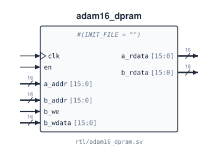

# `adam16_dpram`

**Source:** `rtl/adam16_dpram.sv` · **Instantiated in:** `basys3_top` (as `u_mem`, when `PIPELINED = 1`), `tb_program`, `tb_adam16_gate` (both with `-DPIPE`)

A 64K × 16 dual-port memory with registered (synchronous) reads, for [`adam16_pipe_core`](adam16_pipe_core.md). Port A is read-only and fetches instructions; port B reads and writes data. Both ports see one array, so programs and data share one address space. On the FPGA it maps onto true dual-port block RAM. It has no reset: contents come from `INIT_FILE`, or start uninitialised.



## Parameters

| Name | Type | Default | Description |
|---|---|---|---|
| `INIT_FILE` | string | `""` | Hex image loaded with `$readmemh` at time 0 (simulation) or at configuration (FPGA). `""` loads nothing. `basys3_top` passes its `MEM_INIT` |

## Ports

| Signal | Dir | Width | Type | Reset | Description |
|---|---|---|---|---|---|
| `clk` | in | 1 | clock | — | Clock for both ports |
| `en` | in | 1 | data | — | Enable for both ports: nothing happens on an edge unless `en = 1`. Connect to the core's `ce` |
| `a_addr` | in | 16 | data | — | Port A word address, sampled on every rising edge |
| `a_rdata` | out | 16 | reg | not reset | `a_rdata ← mem[a_addr]` on every rising edge with `en = 1` |
| `b_addr` | in | 16 | data | — | Port B word address, sampled on every rising edge |
| `b_we` | in | 1 | data | — | Port B write enable: `mem[b_addr] ← b_wdata` on the rising edge (when `en = 1`) |
| `b_wdata` | in | 16 | data | — | Port B write data |
| `b_rdata` | out | 16 | reg | not reset | `b_rdata ← mem[b_addr]` on every rising edge with `en = 1`, whether or not `b_we` is set |

## Timing

- **Read latency is one cycle** on both ports.
- **Port B is read-first:** during a write, `b_rdata` gets the old contents.
- **Port A reading the word port B writes on the same edge gets the old word.** In the pipeline this is why a store to one of the next two instruction words is not seen ([details](../07_pipeline.md#what-the-pipeline-does-not-do)).

## Instantiation

<!-- BEGIN GENERATED: instantiation -->
```systemverilog
adam16_dpram #(
  .INIT_FILE ("")
) u_adam16_dpram (
  .clk     (clk),      // in   1
  .en      (en),       // in   1
  .a_addr  (a_addr),   // in  16
  .a_rdata (a_rdata),  // out 16
  .b_addr  (b_addr),   // in  16
  .b_we    (b_we),     // in   1
  .b_wdata (b_wdata),  // in  16
  .b_rdata (b_rdata)   // out 16
);
```
<!-- END GENERATED: instantiation -->
