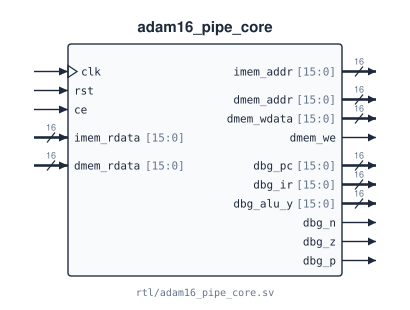

# `adam16_pipe_core`

**Source:** `rtl/adam16_pipe_core.sv` · **Instantiated in:** `basys3_top` (as `u_cpu`, when `PIPELINED = 1`), `tb_program`, `tb_adam16_gate` (both with `-DPIPE`) · **Contains:** `adam16_pipe_decode` (`dec`), `adam16_regfile` (`rf`, `BYPASS = 1`), `adam16_alu` (`alu`)

The five-stage pipelined processor: IF, ID, EX, MEM, WB, with full forwarding, no stalls and one bubble after a taken branch or a jump. It runs the same ISA as [`adam16_core`](adam16_core.md) with the same results. It has two memory ports, fetch and data, for one dual-port memory ([`adam16_dpram`](adam16_dpram.md)); both expect a registered read. How it works: [the pipelined core](../07_pipeline.md).



## Ports

| Signal | Dir | Width | Type | Reset | Description |
|---|---|---|---|---|---|
| `clk` | in | 1 | clock | — | Core clock. Every register in the core updates on the rising edge |
| `rst` | in | 1 | reset | — | One rising edge with `rst = 1` (`ce` is ignored): every stage empty (valid bits 0), fetch PC → `0x0000`, R0–R7 → `0x0000`, N Z P → `0 1 0` |
| `ce` | in | 1 | data | — | Clock enable. The core advances one cycle on each rising edge with `ce = 1` and holds otherwise. Drive the memory's `en` from the same signal |
| `imem_addr` | out | 16 | comb | — | Fetch address for port A: the branch or jump target when EX redirects, else the next sequential PC. Combinational from the EX stage, so it must reach the memory in the same cycle |
| `imem_rdata` | in | 16 | data | — | Instruction word. Must equal `M[imem_addr]` as presented during the *previous* cycle (the memory's read register is the IF/ID instruction register) |
| `dmem_addr` | out | 16 | comb | — | Data address = the ALU output in EX. Presented every cycle; only loads and stores use it |
| `dmem_wdata` | out | 16 | comb | — | Store data: the forwarded source register `R[IR[11:9]]`. Meaningful while `dmem_we = 1` |
| `dmem_we` | out | 1 | comb | — | 1 while a valid store is in EX. Memory writes `M[dmem_addr] ← dmem_wdata` on the edge that ends the cycle |
| `dmem_rdata` | in | 16 | data | — | Load data. Must equal `M[dmem_addr]` as presented during the *previous* cycle (read-first if that edge also wrote it) |
| `dbg_pc` | out | 16 | reg | not reset | PC of the instruction in WB, i.e. retiring this cycle |
| `dbg_ir` | out | 16 | comb | — | Its instruction word, or `0xD000` (NOP) when WB holds a bubble |
| `dbg_alu_y` | out | 16 | reg | not reset | Its result: the value it writes to a register, if it writes one |
| `dbg_n` | out | 1 | reg | not reset | The flags right after it (they change two cycles earlier, in EX) |
| `dbg_z` | out | 1 | reg | not reset | |
| `dbg_p` | out | 1 | reg | not reset | |

## Timing

- **Memory protocol.** Both ports read synchronously: address in cycle *t*, data in cycle *t + 1*. A store writes on the edge that ends the cycle in which `dmem_we = 1`. One fetch and one data access every cycle. Use [`adam16_dpram`](adam16_dpram.md), or any memory with the same timing.
- **Input-to-output combinational paths.** Unlike the multicycle core, this core has some: `dmem_rdata` → forwarding → ALU → `dmem_addr`, `dmem_wdata` and `imem_addr`. They are the core's critical paths ([timing](../07_pipeline.md#timing)). There is no path from `imem_rdata` to an output.
- **Cycles per instruction:** 1, plus 1 after a taken branch, JMP, JSR, JSRR, RET or TRAP. The first instruction retires 5 cycles after reset.
- **Self-modifying code** is not supported within two words of the store ([details](../07_pipeline.md#what-the-pipeline-does-not-do)).

## Connections

Every port and every net that reaches a sub-module, with what drives it and what reads it. Generated from the RTL.

<!-- BEGIN GENERATED: connections -->
| Net | Width | Driven by | Read by |
|---|---|---|---|
| `clk` | 1 | port `clk` | `rf.clk`, `always_ff` logic |
| `rst` | 1 | port `rst` | `rf.rst`, `always_ff` logic |
| `ce` | 1 | port `ce` | `rf.ce`, `always_ff` logic |
| `imem_addr` | 16 | `assign imem_addr = redirect ? target : f_pc` | port `imem_addr`, `always_ff` logic |
| `imem_rdata` | 16 | port `imem_rdata` | `assign d_ir` |
| `dmem_addr` | 16 | `assign` from `alu_y` | port `dmem_addr`, `always_ff` logic |
| `dmem_wdata` | 16 | `assign` from `e_b` | port `dmem_wdata`, `always_ff` logic |
| `dmem_we` | 1 | `assign dmem_we = e_valid && e_mem_we` | port `dmem_we` |
| `dmem_rdata` | 16 | port `dmem_rdata` | `assign m_value` |
| `dbg_pc` | 16 | `assign` from `w_pc` | port `dbg_pc` |
| `dbg_ir` | 16 | `assign dbg_ir = w_valid ? w_ir : 16'hD000` | port `dbg_ir` |
| `dbg_alu_y` | 16 | `assign` from `w_value` | port `dbg_alu_y` |
| `dbg_n` | 1 | `assign dbg_n = w_nzp[2]` | port `dbg_n` |
| `dbg_z` | 1 | `assign dbg_z = w_nzp[1]` | port `dbg_z` |
| `dbg_p` | 1 | `assign dbg_p = w_nzp[0]` | port `dbg_p` |
| `d_ir` | 16 | `assign` from `imem_rdata` | `dec.ir`, `always_ff` logic |
| `d_ra0` | 3 | `dec.ra0` | `rf.ra0`, `always_ff` logic |
| `d_ra1` | 3 | `dec.ra1` | `rf.ra1`, `always_ff` logic |
| `d_rd` | 3 | `dec.rd` | `always_ff` logic |
| `d_reg_we` | 1 | `dec.reg_we` | `always_ff` logic |
| `d_flag_we` | 1 | `dec.flag_we` | `always_ff` logic |
| `d_mem_we` | 1 | `dec.mem_we` | `always_ff` logic |
| `d_wb_sel` | 2 | `dec.wb_sel` | `always_ff` logic |
| `d_alu_op` | 4 | `dec.alu_op` | `always_ff` logic |
| `d_a_sel` | 2 | `dec.a_sel` | `always_ff` logic |
| `d_b_imm` | 1 | `dec.b_imm` | `always_ff` logic |
| `d_imm` | 16 | `dec.imm` | `always_ff` logic |
| `d_br_mask` | 3 | `dec.br_mask` | `always_ff` logic |
| `d_jump` | 1 | `dec.jump` | `always_ff` logic |
| `d_rs0` | 16 | `rf.rd0` | `always_ff` logic |
| `d_rs1` | 16 | `rf.rd1` | `always_ff` logic |
| `rf_we` | 1 | `assign rf_we = w_valid && w_reg_we` | `rf.we` |
| `w_rd` | 3 | `always_ff` logic | `rf.wa`, `assign rt_reg_addr`, `always_comb` logic |
| `w_value` | 16 | `always_ff` logic | `rf.wd`, `assign rt_reg_data`, `assign dbg_alu_y`, `always_comb` logic |
| `e_alu_op` | 4 | `always_ff` logic | `alu.op` |
| `alu_a` | 16 | `always_comb` logic | `alu.a` |
| `alu_b` | 16 | `assign alu_b = e_b_imm ? e_imm : e_b` | `alu.b` |
| `alu_y` | 16 | `alu.y` | `assign e_nzp`, `assign target`, `assign dmem_addr`, `always_ff` logic |
<!-- END GENERATED: connections -->

## Instantiation

<!-- BEGIN GENERATED: instantiation -->
```systemverilog
adam16_pipe_core u_adam16_pipe_core (
  .clk        (clk),         // in   1
  .rst        (rst),         // in   1
  .ce         (ce),          // in   1
  .imem_addr  (imem_addr),   // out 16
  .imem_rdata (imem_rdata),  // in  16
  .dmem_addr  (dmem_addr),   // out 16
  .dmem_wdata (dmem_wdata),  // out 16
  .dmem_we    (dmem_we),     // out  1
  .dmem_rdata (dmem_rdata),  // in  16
  .dbg_pc     (dbg_pc),      // out 16
  .dbg_ir     (dbg_ir),      // out 16
  .dbg_alu_y  (dbg_alu_y),   // out 16
  .dbg_n      (dbg_n),       // out  1
  .dbg_z      (dbg_z),       // out  1
  .dbg_p      (dbg_p)        // out  1
);
```
<!-- END GENERATED: instantiation -->
