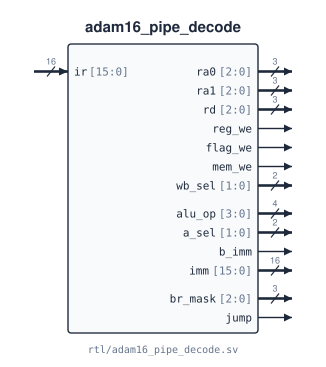

# `adam16_pipe_decode`

**Source:** `rtl/adam16_pipe_decode.sv` · **Instantiated in:** `adam16_pipe_core` (as `dec`, in ID), `tb_pipe_decode_spec`

The pipelined core's instruction decoder: one instruction word in, every control field the later stages need out. Purely combinational. Its specification is `docs/tools/pipe_decode_spec.py`. The [decode table](../07_pipeline.md#decode) is generated from it, and `make -C docs check` compares this module with it for all 65536 instruction words.



## Ports

| Signal | Dir | Width | Type | Reset | Description |
|---|---|---|---|---|---|
| `ir` | in | 16 | data | — | Instruction word |
| `ra0` | out | 3 | comb | — | Register read port 0: SR1 / BaseR (`IR[8:6]`), R7 for RET |
| `ra1` | out | 3 | comb | — | Register read port 1: SR2 (`IR[5:3]`), the store source SR (`IR[11:9]`) for ST and STR |
| `rd` | out | 3 | comb | — | Destination: DR (`IR[11:9]`), R7 for JSR, JSRR and TRAP |
| `reg_we` | out | 1 | comb | — | Writes a register: every ALU op except CMP, ADDI, ANDI, LD, LDR, LEA, JSR, JSRR, TRAP |
| `flag_we` | out | 1 | comb | — | Sets N Z P from the ALU output: ALU0, ALU1 (CMP included), ADDI, ANDI |
| `mem_we` | out | 1 | comb | — | Store: ST, STR |
| `wb_sel` | out | 2 | comb | — | What is written: 0 = ALU output, 1 = PC+1 (link), 2 = load data |
| `alu_op` | out | 4 | comb | — | `{group, funct}` as [`adam16_alu`](adam16_alu.md): the instruction's own for ALU0 / ALU1, else ADD, AND (ANDI) or MOV (JMP, JSRR, RET) |
| `a_sel` | out | 2 | comb | — | ALU input a: 0 = `R[ra0]`, 1 = PC+1, 2 = zero |
| `b_imm` | out | 1 | comb | — | ALU input b: 0 = `R[ra1]`, 1 = `imm` |
| `imm` | out | 16 | comb | — | The immediate, extended: SEXT(imm6 / off6), ZEXT(imm6), SEXT(off9), SEXT(off11) or ZEXT(trapvect12). 0 for instructions without one |
| `br_mask` | out | 3 | comb | — | BR: the `n z p` mask `IR[11:9]`. 0 for every other instruction, so NOP and non-branches never redirect |
| `jump` | out | 1 | comb | — | Always redirects: JMP, JSR, JSRR, RET, TRAP |

Undefined opcodes `0xE` and `0xF` decode to nothing at all: no write, no flags, no redirect.

## Instantiation

<!-- BEGIN GENERATED: instantiation -->
```systemverilog
adam16_pipe_decode u_adam16_pipe_decode (
  .ir      (ir),       // in  16
  .ra0     (ra0),      // out  3
  .ra1     (ra1),      // out  3
  .rd      (rd),       // out  3
  .reg_we  (reg_we),   // out  1
  .flag_we (flag_we),  // out  1
  .mem_we  (mem_we),   // out  1
  .wb_sel  (wb_sel),   // out  2
  .alu_op  (alu_op),   // out  4
  .a_sel   (a_sel),    // out  2
  .b_imm   (b_imm),    // out  1
  .imm     (imm),      // out 16
  .br_mask (br_mask),  // out  3
  .jump    (jump)      // out  1
);
```
<!-- END GENERATED: instantiation -->
