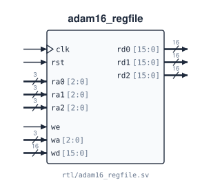

# `adam16_regfile`

**Source:** `rtl/adam16_regfile.sv` · **Instantiated in:** `adam16_datapath` (as `rf`, `BYPASS = 0`), `adam16_pipe_core` (as `rf`, `BYPASS = 1`)

Eight 16-bit general-purpose registers, R0–R7, with two read ports and one write port. Reads are asynchronous (combinational) and the write is synchronous. No instruction ever needs more than two register reads at once, so two ports are enough.



## Parameters

| Name | Type | Default | Description |
|---|---|---|---|
| `BYPASS` | bit | `1'b0` | `1`: a read of the register being written returns the new value `wd` in the same cycle (write-first). The pipelined core needs this; the multicycle core must leave it at 0, because its write data is computed from its own read data in the same cycle and a bypass would form a combinational loop |

## Ports

| Signal | Dir | Width | Type | Reset | Description |
|---|---|---|---|---|---|
| `clk` | in | 1 | clock | — | Write clock |
| `rst` | in | 1 | reset | — | Clears R0–R7 to `0x0000` (regardless of `ce`) |
| `ce` | in | 1 | data | — | Clock enable: writes happen only on edges with `ce = 1` |
| `ra0` | in | 3 | data | — | Read address, port 0. Combinational path to `rd0` |
| `ra1` | in | 3 | data | — | Read address, port 1. Combinational path to `rd1` |
| `rd0` | out | 16 | comb | — | `R[ra0]` (or `wd` when bypassing) |
| `rd1` | out | 16 | comb | — | `R[ra1]` (or `wd` when bypassing) |
| `we` | in | 1 | data | — | Write enable |
| `wa` | in | 3 | data | — | Write address |
| `wd` | in | 16 | data | — | Write data: `R[wa] ← wd` on the rising edge when `we = 1` and `ce = 1` |

## Timing

- **Reads follow their address combinationally.** `rd*` also changes just after any edge that writes the register it is reading.
- **`BYPASS = 0`:** a register read and written in the same cycle returns the *old* value until the edge. The multicycle controller never needs the new value sooner than four cycles later.
- **`BYPASS = 1`:** the same read returns `wd` immediately, so the pipeline's decode stage sees a value being written back in the same cycle.
- **R0 is not hard-wired to zero.** It is cleared by reset like the other registers and can be written.
- **Implementation.** The whole array is reset, so synthesis typically builds it from flip-flops plus 8:1 read muxes rather than distributed RAM, which has no reset.

## How the multicycle datapath connects it

| Port | Connected to | Meaning |
|---|---|---|
| `ra0` | `IR[8:6]` | SR1 / BaseR |
| `ra1` | `IR[5:3]`, `IR[11:9]` or `3'b111`, by `ra1_sel` | SR2 / store source (ST, STR) / R7 (RET) |
| `wa` | `reg_dst` | `IR[11:9]` or `3'b111` |
| `wd` | `wb_data` | write-back mux output |
| `rd1` | ALU B input 0, `mem_wdata`, PC mux input 4 | SR2 / store data / RET target |

## Instantiation

<!-- BEGIN GENERATED: instantiation -->
```systemverilog
adam16_regfile #(
  .BYPASS (1'b0)
) u_adam16_regfile (
  .clk (clk),  // in   1
  .rst (rst),  // in   1
  .ce  (ce),   // in   1
  .ra0 (ra0),  // in   3
  .ra1 (ra1),  // in   3
  .rd0 (rd0),  // out 16
  .rd1 (rd1),  // out 16
  .we  (we),   // in   1
  .wa  (wa),   // in   3
  .wd  (wd)    // in  16
);
```
<!-- END GENERATED: instantiation -->
