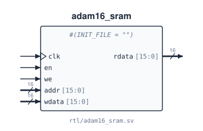

# `adam16_sram`

**Source:** `rtl/adam16_sram.sv` · **Instantiated in:** `basys3_top` (as `imem`), `tb_adam16`, `tb_adam16_gate`

A 64K × 16 single-port memory with a registered (synchronous) read. In simulation it is the program and data memory. On the FPGA it is written in the synchronous-read style that synthesis maps to block RAM. It has no reset: contents come from `INIT_FILE`, or start uninitialised.



## Parameters

| Name | Type | Default | Description |
|---|---|---|---|
| `INIT_FILE` | string | `""` | Hex image loaded with `$readmemh` at time 0 (simulation) or at configuration (FPGA). `""` loads nothing. `basys3_top` passes an absolute path ([known issues](../06_known_issues.md#4-repository-housekeeping)) |

## Ports

| Signal | Dir | Width | Type | Reset | Description |
|---|---|---|---|---|---|
| `clk` | in | 1 | clock | — | Read and write clock |
| `we` | in | 1 | data | — | Write enable: `mem[addr] ← wdata` on the rising edge |
| `addr` | in | 16 | data | — | Word address, sampled on every rising edge |
| `wdata` | in | 16 | data | — | Write data |
| `rdata` | out | 16 | reg | not reset | `rdata ← mem[addr]` on **every** rising edge, whether or not `we` is set |

## Timing

- **Read latency is one cycle.** The address presented during cycle *t* appears on `rdata` during cycle *t + 1*.
- **Read-during-write returns the old contents** (read-first). The new value appears the cycle after. `adam16_core` never uses `rdata` right after a write, so a write-first or no-change memory would also work.
- Waveforms for fetch, load and store: [memory interface](../04_memory.md).

## Instantiation

<!-- BEGIN GENERATED: instantiation -->
```systemverilog
adam16_sram #(
  .INIT_FILE ("")
) u_adam16_sram (
  .clk   (clk),    // in   1
  .we    (we),     // in   1
  .addr  (addr),   // in  16
  .wdata (wdata),  // in  16
  .rdata (rdata)   // out 16
);
```
<!-- END GENERATED: instantiation -->
