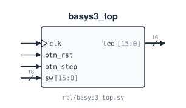

# `basys3_top`

**Source:** `rtl/basys3_top.sv` · **Top level for:** the Vivado project (`fpga/`) · **Contains:** `debounce` (`db_rst`, `db_step`), `cpu16_core` (`u_cpu`), `SramSBC` (`imem`)

The FPGA wrapper for the Digilent Basys3. It keeps the memory bus on-chip, lets a person single-step the CPU with a button, and shows one of four debug words on the 16 LEDs. Pin assignments are in `fpga/constraints/adam16.xdc`. How to use it: [`demo.md`](../../demo.md).



## Ports

| Signal | Dir | Width | Type | Reset | Description |
|---|---|---|---|---|---|
| `clk` | in | 1 | clock | — | 100 MHz oscillator, pin W5. Clocks only the two debouncers |
| `btn_rst` | in | 1 | async | — | btnC (U18). Debounced level → core `rst`; each press also makes one core clock edge, so the reset takes effect |
| `btn_step` | in | 1 | async | — | btnU (T18). Each debounced press makes exactly one core clock edge |
| `sw` | in | 16 | async | — | Slide switches. `sw[1:0]` picks the LED view (`00` PC, `01` IR, `10` ALU output, `11` `{13'b0,N,Z,P}`); `sw[15:2]` unused. Feeds the LED mux directly, with no synchronizer (it only drives LEDs) |
| `led` | out | 16 | comb | — | Debug word selected by `sw[1:0]` |

## Clocking

The core and memory run on `core_clk = step_pulse | rst_pulse`. That clock is generated by logic, which suits hand-stepping but isn't timed or glitch-safe ([known issues](../06_known_issues.md#2-basys3_top-generates-a-clock-from-logic)). The step debouncer's `btn_clean` level output is left unconnected; only its pulse is used.

## Connections

Every port and every internal net. Generated from the RTL.

<!-- BEGIN GENERATED: connections -->
| Net | Width | Driven by | Read by |
|---|---|---|---|
| `clk` | 1 | port `clk` | `db_rst.clk`, `db_step.clk` |
| `btn_rst` | 1 | port `btn_rst` | `db_rst.btn_in` |
| `btn_step` | 1 | port `btn_step` | `db_step.btn_in` |
| `sw` | 16 | port `sw` | `always_comb` logic |
| `led` | 16 | `always_comb` logic | port `led` |
| `rst_clean` | 1 | `db_rst.btn_clean` | `u_cpu.rst` |
| `rst_pulse` | 1 | `db_rst.btn_pulse` | `assign core_clk` |
| `step_pulse` | 1 | `db_step.btn_pulse` | `assign core_clk` |
| `core_clk` | 1 | `assign core_clk = step_pulse \| rst_pulse` | `u_cpu.clk`, `imem.clk` |
| `mem_rdata` | 16 | `imem.rdata` | `u_cpu.mem_rdata` |
| `mem_addr` | 16 | `u_cpu.mem_addr` | `imem.addr` |
| `mem_wdata` | 16 | `u_cpu.mem_wdata` | `imem.wdata` |
| `mem_we` | 1 | `u_cpu.mem_we` | `imem.we` |
| `dbg_pc` | 16 | `u_cpu.dbg_pc` | `always_comb` logic |
| `dbg_ir` | 16 | `u_cpu.dbg_ir` | `always_comb` logic |
| `dbg_alu_y` | 16 | `u_cpu.dbg_alu_y` | `always_comb` logic |
| `dbg_n` | 1 | `u_cpu.dbg_n` | `always_comb` logic |
| `dbg_z` | 1 | `u_cpu.dbg_z` | `always_comb` logic |
| `dbg_p` | 1 | `u_cpu.dbg_p` | `always_comb` logic |
<!-- END GENERATED: connections -->

## Instantiation

<!-- BEGIN GENERATED: instantiation -->
```systemverilog
basys3_top u_basys3_top (
  .clk      (clk),       // in   1
  .btn_rst  (btn_rst),   // in   1
  .btn_step (btn_step),  // in   1
  .sw       (sw),        // in  16
  .led      (led)        // out 16
);
```
<!-- END GENERATED: instantiation -->
