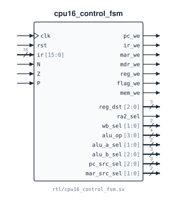

# `cpu16_control_fsm`

**Source:** `rtl/cpu16_control_fsm.sv` · **Instantiated in:** `cpu16_core` (as `u_ctrl`) · **Imports:** `cpu16_isa`

The controller: a 14-state machine and the only block that decodes the opcode. Each cycle it drives every datapath enable and mux select, plus the memory write enable, from its state, the instruction register and the condition flags.



## Ports

All outputs are combinational functions of `(state, ir, N, Z, P)` and default to 0. Six of them depend on the state alone: `ir_we`, `mar_we`, `mdr_we`, `mem_we`, `wb_sel` and `mar_src_sel`. The states named in each description are the only ones that change that output. The complete per-state values are in the [bubble diagrams](../03_control.md#bubble-diagrams) and the [control-signal table](../03_control.md#control-signal-table).

| Signal | Dir | Width | Type | Reset | Description |
|---|---|---|---|---|---|
| `clk` | in | 1 | clock | — | State register clock |
| `rst` | in | 1 | reset | — | Next edge goes to `S_IF0`, from any state |
| `ir` | in | 16 | data | — | Instruction register. `op = IR[15:12]` picks the execute path in `S_ID`. `op`, `fn = IR[2:0]`, `DR = IR[11:9]` and `j = IR[11]` pick the output values. Combinational path to `pc_we`, `reg_we`, `flag_we`, `reg_dst`, `ra2_sel`, `alu_op`, `alu_a_sel`, `alu_b_sel`, `pc_src_sel` and the next-state logic. `IR[8:3]` is never used |
| `N` | in | 1 | data | — | Negative flag. Reaches only `pc_we` and `pc_src_sel`, through `take_br` in `S_EX_BR` |
| `Z` | in | 1 | data | — | Zero flag. Reaches only `pc_we` and `pc_src_sel`, through `take_br` in `S_EX_BR` |
| `P` | in | 1 | data | — | Positive flag. Reaches only `pc_we` and `pc_src_sel`, through `take_br` in `S_EX_BR` |
| `pc_we` | out | 1 | comb | — | PC write. 1 in `S_IF2`, `S_EX_JMP`, `S_EX_JSR`, `S_EX_TRAP`, and in `S_EX_BR` when `take_br` |
| `ir_we` | out | 1 | comb | — | IR write. 1 in `S_IF2` |
| `mar_we` | out | 1 | comb | — | MAR write. 1 in `S_IF0` and `S_EX_EA` |
| `mdr_we` | out | 1 | comb | — | MDR write. 1 in `S_MEM_RD1` |
| `reg_we` | out | 1 | comb | — | Register-file write. 1 in `S_EX_ALU` (except CMP), `S_WB_LD`, `S_EX_JSR`, `S_EX_TRAP` |
| `flag_we` | out | 1 | comb | — | N/Z/P write. 1 in `S_EX_ALU` except for LEA |
| `mem_we` | out | 1 | comb | — | Memory write. 1 in `S_MEM_WR0`. Depends on the state only |
| `reg_dst` | out | 3 | comb | — | Register write address: `DR` in `S_EX_ALU` and `S_WB_LD`; `111` (R7) in `S_EX_JSR` and `S_EX_TRAP` |
| `ra2_sel` | out | 1 | comb | — | Read port 2 address: `1` = R7 in `S_EX_JMP` for RET; otherwise `0` = `IR[11:9]` |
| `wb_sel` | out | 2 | comb | — | Write-back source: `00` alu_y, `01` MDR (`S_WB_LD`), `10` PC (`S_EX_JSR`, `S_EX_TRAP`) |
| `alu_op` | out | 4 | comb | — | ALU operation `{group, funct}` (see [`cpu16_alu`](cpu16_alu.md#operations)). `{0,fn}` / `{1,fn}` for ALU0 / ALU1, `0011` for ANDI, `0000` (ADD) otherwise |
| `alu_a_sel` | out | 2 | comb | — | ALU A: `00` rd0, `01` PC (LEA, LD/ST address) |
| `alu_b_sel` | out | 3 | comb | — | ALU B: `000` rd1, `001` SEXT(imm6), `010` ZEXT(imm6), `011` SEXT(off9), `100` SEXT(off6), `111` zero |
| `pc_src_sel` | out | 3 | comb | — | PC next value: `000` PC+1, `001` PC+off9, `010` PC+off11, `011` BaseR, `100` R7, `101` ZEXT(tv12) |
| `mar_src_sel` | out | 2 | comb | — | MAR next value: `00` PC, `01` alu_y |

## Timing

- **The state register** is 5 bits, updated on every rising edge (`S_IF0` = 0 … `S_EX_TRAP` = 13). Codes 14–31 are unreachable and recover to `S_IF0`.
- **Outputs are Mealy with respect to this module.** They change combinationally with `ir`, `N`, `Z` and `P` as well as with the state. In the core, those inputs come from datapath registers, so the outputs still change only just after a clock edge (see [Moore or Mealy?](../03_control.md#moore-or-mealy)).
- **IR is held for the whole instruction.** The datapath loads IR on the edge that ends `S_IF2` and keeps it until the next `S_IF2`. So in each execute state, only the opcodes that lead to that state can occur.

## State machine


The overview shows states and next-state conditions. The detailed bubble diagrams in [03_control.md](../03_control.md#bubble-diagrams) give every arc as *condition / outputs*. They are generated from `docs/tools/fsm_spec.py`, and `make -C docs check` proves that spec equal to this RTL for every opcode, field and flag combination.

## Instantiation

<!-- BEGIN GENERATED: instantiation -->
```systemverilog
cpu16_control_fsm u_cpu16_control_fsm (
  .clk         (clk),          // in   1
  .rst         (rst),          // in   1
  .ir          (ir),           // in  16
  .N           (N),            // in   1
  .Z           (Z),            // in   1
  .P           (P),            // in   1
  .pc_we       (pc_we),        // out  1
  .ir_we       (ir_we),        // out  1
  .mar_we      (mar_we),       // out  1
  .mdr_we      (mdr_we),       // out  1
  .reg_we      (reg_we),       // out  1
  .flag_we     (flag_we),      // out  1
  .mem_we      (mem_we),       // out  1
  .reg_dst     (reg_dst),      // out  3
  .ra2_sel     (ra2_sel),      // out  1
  .wb_sel      (wb_sel),       // out  2
  .alu_op      (alu_op),       // out  4
  .alu_a_sel   (alu_a_sel),    // out  2
  .alu_b_sel   (alu_b_sel),    // out  3
  .pc_src_sel  (pc_src_sel),   // out  3
  .mar_src_sel (mar_src_sel)   // out  2
);
```
<!-- END GENERATED: instantiation -->
