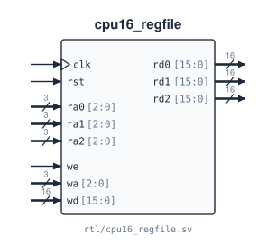

# `cpu16_regfile`

**Source:** `rtl/cpu16_regfile.sv` · **Instantiated in:** `cpu16_datapath` (as `rf`)

Eight 16-bit general-purpose registers, R0–R7, with three read ports and one write port. Reads are asynchronous (combinational) and the write is synchronous.



## Ports

| Signal | Dir | Width | Type | Reset | Description |
|---|---|---|---|---|---|
| `clk` | in | 1 | clock | — | Write clock |
| `rst` | in | 1 | reset | — | Clears R0–R7 to `0x0000` |
| `ra0` | in | 3 | data | — | Read address, port 0. Combinational path to `rd0` |
| `ra1` | in | 3 | data | — | Read address, port 1. Combinational path to `rd1` |
| `ra2` | in | 3 | data | — | Read address, port 2. Combinational path to `rd2` |
| `rd0` | out | 16 | comb | — | `R[ra0]` |
| `rd1` | out | 16 | comb | — | `R[ra1]` |
| `rd2` | out | 16 | comb | — | `R[ra2]` |
| `we` | in | 1 | data | — | Write enable |
| `wa` | in | 3 | data | — | Write address |
| `wd` | in | 16 | data | — | Write data: `R[wa] ← wd` on the rising edge when `we = 1` |

## Timing

- **Reads follow their address combinationally.** `rd*` also changes just after any edge that writes the register it is reading.
- **No bypass.** If a register is read and written in the same cycle, the read returns the *old* value until the edge. The multi-cycle controller never needs the new value sooner than four cycles later, so this is safe today. A pipeline would need write-first behaviour or forwarding.
- **R0 is not hard-wired to zero.** It is cleared by reset like the other registers and can be written.
- **Implementation.** The whole array is reset, so synthesis typically builds it from flip-flops plus 8:1 read muxes rather than distributed RAM, which has no reset. The core never uses more than two read ports in the same cycle ([known issues](../06_known_issues.md#3-the-register-file-has-one-more-read-port-than-any-instruction-uses)).

## How the datapath connects it

| Port | Connected to | Meaning |
|---|---|---|
| `ra0` | `IR[8:6]` | SR1 / BaseR |
| `ra1` | `IR[5:3]` | SR2 |
| `ra2` | `IR[11:9]`, or `3'b111` when `ra2_sel = 1` | store source (ST/STR) / R7 (RET) |
| `wa` | `reg_dst` | `IR[11:9]` or `3'b111` |
| `wd` | `wb_data` | write-back mux output |
| `rd2` | `mem_wdata`, PC mux input 4 | store data / RET target |

## Instantiation

<!-- BEGIN GENERATED: instantiation -->
```systemverilog
cpu16_regfile u_cpu16_regfile (
  .clk (clk),  // in   1
  .rst (rst),  // in   1
  .ra0 (ra0),  // in   3
  .ra1 (ra1),  // in   3
  .ra2 (ra2),  // in   3
  .rd0 (rd0),  // out 16
  .rd1 (rd1),  // out 16
  .rd2 (rd2),  // out 16
  .we  (we),   // in   1
  .wa  (wa),   // in   3
  .wd  (wd)    // in  16
);
```
<!-- END GENERATED: instantiation -->
