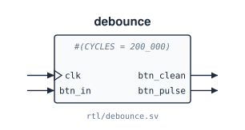
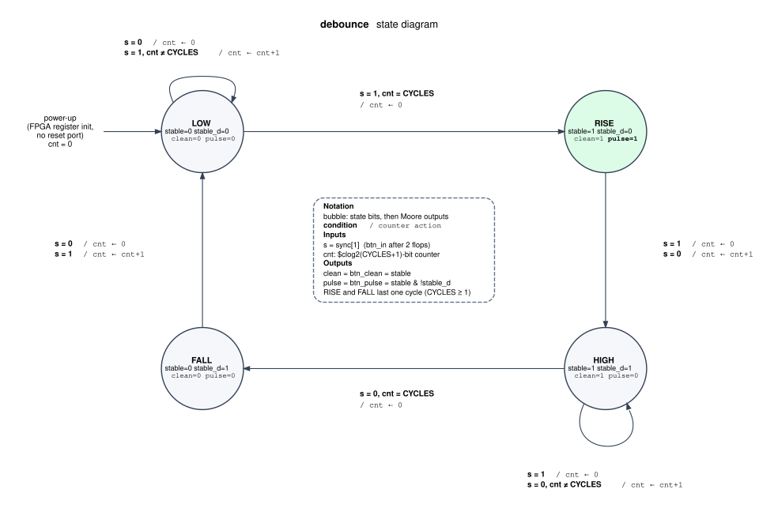

# `debounce`

**Source:** `rtl/debounce.sv` · **Instantiated in:** `basys3_top` (as `db_rst` and `db_step`)

Turns a bouncing push-button into a clean level and a one-cycle pulse. A 2-flop synchronizer brings the button into the `clk` domain. A counter then accepts a new level only after the synchronized input has disagreed with the current level for `CYCLES + 1` consecutive clocks.



## Parameters

| Name | Type | Default | Description |
|---|---|---|---|
| `CYCLES` | int | `200_000` | Counter limit. With a 100 MHz `clk`, 200 000 cycles ≈ 2 ms. Must be ≥ 1. The counter is `$clog2(CYCLES+1)` bits wide |

## Ports

| Signal | Dir | Width | Type | Reset | Description |
|---|---|---|---|---|---|
| `clk` | in | 1 | clock | — | Sampling clock (100 MHz on the Basys3) |
| `btn_in` | in | 1 | async | — | Raw button. Asynchronous; passes through 2 flip-flops before use |
| `btn_clean` | out | 1 | reg | none (power-up 0) | Debounced level: the `stable` flip-flop |
| `btn_pulse` | out | 1 | comb | none (power-up 0) | `stable & ~stable_d`: high for exactly one `clk` cycle after each rising edge of `btn_clean` |

There is no reset input. Every flip-flop has a declared power-up value of 0 (state LOW, `cnt = 0`), which the FPGA honours at configuration and simulators apply at time 0. ASIC synthesis ignores power-up values, but this module is only used on the FPGA.

## State machine



The state is the pair `{stable, stable_d}`, and the counter `cnt` sits beside it as an extended-state register. Outputs depend on the state only (Moore), so they are written inside the bubbles. Arcs read *condition / counter action*, where `s` is the synchronized button `sync[1]`. RISE and FALL each last exactly one cycle, because `cnt` was just cleared and can't reach `CYCLES` again that soon.

The diagram was checked against the RTL in simulation, with `CYCLES = 3` and a random bouncing input: 3,999 consecutive transitions, including 212 RISE/FALL visits, with no mismatch.

## Timing

| Event | Delay (rising `clk` edges) | At `CYCLES = 200_000`, 100 MHz |
|---|---|---|
| `btn_in` changes and stays → `btn_clean` follows | `CYCLES + 3`: 2 synchronizer flops, then `CYCLES + 1` counted cycles | ≈ 2.00003 ms |
| `btn_clean` rises → `btn_pulse` | same edge; `btn_pulse` is high for 1 cycle | 10 ns pulse |
| A bounce shorter than `CYCLES + 1` cycles | ignored; `cnt` returns to 0 | — |

The `CYCLES + 3` figure was measured in simulation (`CYCLES = 3` gives 6 edges).

## Instantiation

<!-- BEGIN GENERATED: instantiation -->
```systemverilog
debounce #(
  .CYCLES (200_000)
) u_debounce (
  .clk       (clk),        // in   1
  .btn_in    (btn_in),     // in   1
  .btn_clean (btn_clean),  // out  1
  .btn_pulse (btn_pulse)   // out  1
);
```
<!-- END GENERATED: instantiation -->
